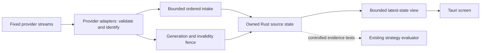

# Issue #5: connect trustworthy BTC market data

**Later owner clarification:** delete the current capacity campaigns, collectors, diagnostics and their exclusive hooks/tests; do not retain opt-in tooling for issue16. The old implementation and commands below are retired historical design, not a prototype checklist. Use the [current completion plan](completion-plan.md). Issue16 will choose measurements justified by the integrated product later.

## Owner-approved prototype scope amendment — 18 November 2026

Connor directed: “push that to 16” and “We really just need a working prototype at gh issue 5.” Sustained-capacity calibration, the separate frozen qualification, performance tuning and collector/benchmark validation now belong to issue 16. They are not prerequisites for completing the read-only source prototype in issue 5 or the controlled paper lifecycle in issue 6. Do not run those campaigns during prototype work. This supersedes the performance sequencing below; it does not claim the historical failed qualification passed.

Keep ordinary source correctness, truthful unavailable states, exact financial/history behavior, read-only access, stale-result invalidation, bounded admission and joined shutdown. Required availability/access/usage evidence remains explicit; this amendment does not grant credentials, provider/account access, paid services, trading or publication authority. The archived numerical contract/results remain in [performance](../../sources/performance.md) and the sole [issue-5 evidence record](../../verification/issue-5.md). Issue 16 owns their later disposition.

* **Author:** Connor Moulton
* **Status:** Approved design direction — independent review completed; requested design corrections applied. Implementation explicitly not authorized.
* **Date:** 2026-11-14
* **Tracker:** [GitHub issue #5](https://github.com/moultonlavah/metten/issues/5)
* **Approved predecessor:** [Reviewed concepts brief](concepts_brief.md)

This is design work only. Brief approval authorizes drafting; it does not authorize implementation, account access, paid services or trading. The [product specification](../../../METTEN_DESIGN_DRAFT_2026-11-12.md), [accepted architecture](../../../docs/adr/0001-rust-engine-and-tauri-boundaries.md) and [strategy reference](../../../docs/strategies/reference.md) remain the behavioral authorities.

## Approval, Reconciliation and Authority

Connor approved the Overview/Goals/intake requirements, the Tokio direction, the Technical Plan including rollover, Alternatives Considered and the Detailed Implementation Plan during this design session on November 14, 2026. His final instruction was: “I approve the implementation plan, do not implement.” Approval is for the design only. Implementation, dependency installation, builds, account access, deployment and trading have not been authorized by this document.

The lead reread the approved predecessor and reconciled the design against it. No contradiction was found in source identity, existing strategy meanings, history/gap semantics, read-only scope, credential protection or the exclusion of exact D–H reproduction. Approved refinements are the concrete Tokio/transport/signing dependencies, native source commands and module placement, initial resource/request/deadline profiles, proactive rollover and the complete file/test inventory. These refine questions already raised in the brief and were covered by the subsequent section approvals; they are not unapproved additions at finalization.

Initial numerical profiles and exploratory latency targets are design settings awaiting feasibility/calibration evidence, not observed provider limits or demonstrated performance. Unsupported continuity, field mapping, access/rights, client behavior and actual performance remain explicit gates. Approving the plan does not waive them.

The seven-lens review assessed the brainstorm input. The subsequent [independent formal review](reviews/consolidated_review_report.md) assessed the complete design and found four material contract gaps plus wording corrections. Connor then instructed “Fix them with a sub agent.” This revision applies those document corrections, tracked in the [resolution record](reviews/resolution_report.md); it does not claim a new independent clean review or authorize implementation.

Supporting records:

* [Approved concepts brief](concepts_brief.md).
* [Brainstorm findings and dispositions](goldfish-review.md).
* [Archived brainstorm input](brainstorm-review-input.md).
* [External public-source research](external-inputs-research.md).
* [Plain-English visual guide](plan-guide.html), explanatory rather than an acceptance specification.

## Overview

Metten will connect the named information needed by its supported BTC 15-minute strategies and show whether that information can actually be used. The owner can inspect the current market and source details, understand a missing connection or unavailable input, and see when recovery has restored only a current price rather than the history a calculation needs.

BRTI delivered through Kalshi is the preferred BTC reference for strategies that explicitly choose it. Coinbase and Kraken remain separately identified BTC/USD prices. They are alternative sources a strategy can name, not automatic substitutes for BRTI. The existing learning example uses Kalshi contract asks and does not acquire a new BRTI requirement.

This slice includes Kalshi market details, books and trades; BRTI; Coinbase and Kraken last trades; guided source setup; provider-specific protected credential integration; source health; and bounded read-only details. The planned connection path stays inside the Rust application. The Technical Plan below selects the libraries, interfaces and initial operating profile against the required behavior.

The result is a trustworthy read-only data foundation for later paper and live integration. No purchase endpoint is available through this slice, and displaying current data does not establish that a strategy is connected, eligible to trade or ready for release.

## The Problem

Metten currently validates and explains supported strategy rules using controlled inputs. It has not established a connection from those named inputs to real provider data. Its existing credential proof uses an isolated dummy item; it is not a production Kalshi credential connection.

A successful login or subscription acknowledgment can look healthy while the required data is absent. A feed can also recover a fresh price while leaving a gap that makes a rolling calculation unusable. Different providers report different prices and offer different evidence about missed updates. Hiding those differences could change a strategy's meaning or present unsupported confidence.

The owner needs one clear setup and inspection experience: identify the required source, establish the exact field and market meaning, show verified data when available, and explain the specific limitation when it is not. Processing must keep up with an explicitly stated supported workload without silently dropping meaningful observations. BRTI's preferred status reflects the owner's direction and settlement relevance; superior uptime has not been measured.

## Goals

1. **Identify the exact supported information.** For each existing named binding, record its provider field, units, instrument/market/side, observation identity, delivery profile and precision. Establish separately what proves a current value, complete historical intervals and recovery. Report unsupported uses explicitly.
2. **Complete a guided read-only connection experience.** Show the supported Kalshi BTC15m market and the selected strategy's source requirements. Connect Kalshi, BRTI, Coinbase and Kraken within their established access and capability limits. Prove receipt of the correct data rather than treating acknowledgment as success.
3. **Integrate credentials securely.** Define provider-specific native credential save, replace, remove and trusted signing access using protected Mac Keychain. Preserve the existing isolated dummy checks. Verify the new path with controlled secrets; keep secrets out of the screen's returned state, SQLite, logs and exports.
4. **Preserve distinct meanings.** Keep BRTI tick, trailing average, provisional closing average and established market references separate. Retain Kalshi quantities and trade direction/size as bounded provider details without adding new strategy JSON capabilities. Never silently change a source or a saved strategy's meaning.
5. **Explain usable data truthfully.** Distinguish missing configuration, confirmed access refusal, unexplained absence, stale data, disconnection, rebuilding and local overload. Show current-price validity separately from history readiness, with affected inputs and a useful next action.
6. **Recover without inventing evidence.** Controlled checks must show that duplicate/replayed messages do not count as new observations, snapshots restore present state without repairing old gaps, and overload makes affected data unavailable. Preserve the existing engine's observation and history contracts.
7. **Demonstrate bounded processing.** State the admitted workload, account for pending work and transport memory, and measure receipt-to-acceptance and completed-evaluation delays, backlog and recovery. Preserve brief meaningful excursions during bursts. Provider cadence is separate from application delay; no numerical speed target is approved by this section.
8. **Keep acceptance evidence honest.** Exercise healthy, wrong-source, absent-data and denied-access fixtures; prove the read-only request boundary and focused packaged credential/status behavior. Record source availability and retention/use constraints. Separate controlled evidence from separately authorized account checks and real-feed measurements; identify every missing required proof.

9. **Make state ownership explicit.** Define connection, subscription, current-value, continuity and evaluation-progress states separately, including who changes each state and how late responses or obsolete connections are rejected. A single green connected flag is insufficient.
10. **Budget every provider request.** List startup, steady-state, market-rollover and recovery calls separately; distinguish REST token costs, connection attempts and WebSocket control messages. Bound concurrency, total deadlines and retries, share subscriptions, and show actual usage rather than infer it from UI refreshes.
11. **Measure useful throughput, not parser speed alone.** Benchmark both intake in isolation and the full path through representative existing evaluator workloads. Record offered, admitted, completed and invalidated work, tail delay, oldest unfinished work and recovery, with no loss disguised by averages or faster replay.
12. **Document the running system as part of delivery.** Provide a linked intake guide covering states, data flow, provider profiles, budgets, recovery, benchmarks, troubleshooting and ownership. Distinguish planned, implemented and measured behavior; keep one authoritative contract for each fact.
13. **Prepare market rollover before it happens.** Maintain a bounded current/next-market pair, verify the next market's data in advance, and use the known opening time for one ordered handoff. A prepared handoff needs no new market-search request at the boundary. Missing next-market evidence triggers bounded discovery and an honest waiting state, never a tight polling loop or reuse of the previous contract.

## Non-Goals

* Purchase submission, fill simulation, order/account recovery, paper qualification or live trading.
* Reproducing D–H rules, importing their code or thresholds, or adding their scoring, multi-day history, hedge and exit behavior.
* Changing format-2 bindings, adding author-selectable flow/quantity/average operators, or changing existing history and precision semantics.
* Automatic replacement of BRTI with another exchange price, a mutable best-price source, direct CF redundancy or additional providers/assets.
* Additional signed spot-trade channels, derivatives/options/liquidation feeds, other prediction-market odds or economic-event inputs. The research shortlist does not make these issue #5 requirements.
* Continuous raw-feed archives, hosted telemetry, a general-purpose SDK, a separate Python runtime or an unmeasured performance/uptime promise.
* Accessing real credentials/accounts, buying entitlement or exercising paid services under design approval.

## Open Evidence for the Technical Plan

These are engineering investigations, not requests for the owner to choose internal mechanisms:

* Exact provider field and continuity guarantees for every existing binding, including quiet intervals and authoritative market-reference correspondence.
* Compatibility verification for the selected direct Rust integration, authentication libraries and fixed delivery profile in the Technical Plan.
* Controlled verification of the fixed protected credential identity and restart behavior specified below; connections remain session-local and SQLite is unchanged.
* Source-specific freshness/retry limits, full-path memory admission and a bounded acceptance workload, with a measurement method that can expose failure.
* Official retention/use constraints, access conditions and any unavailable proof. Paid rights, an infeasible promised capability or changed strategy meaning require a concrete owner decision if discovered.

The following intake requirements are approved design constraints. The Technical Plan below proposes their implementation. Section approval is not implementation or account authority.

## Intake Requirements — Deeper Design Record

### Purpose and performance standard

Data intake is part of the engine's decision infrastructure, not a screen feed. Preserve the useful information within the approved source profile: source identity, every relevant observation and book change, quantities, times and continuity evidence. Do not collect unrelated feeds merely because they are available. A strategy can evaluate only the information actually received, validated and processed by its decision time.

Rust is the selected implementation language, not performance evidence. The target is small and measured local delay at a stated workload, with bounded resources and prompt invalidation outside that workload. No design can promise zero network timeouts, maximum possible performance or a trading edge. Failures must instead have known deadlines, bounded costs and explicit effects. Improving data speed or quality enables an edge to be tested; it does not establish one.

### States and ownership

These are separate dimensions, not a multiplication into one enormous state machine. Each module owns its state; the displayed status is a derived view. Exact Rust types belong in the Technical Plan.

| Dimension | States/facts that must be distinguishable | Owner and transition rule |
| --- | --- | --- |
| Connection | Disabled, missing configuration, connecting, open, waiting to reconnect, access refused, shutting down | Provider connection module; socket-open proves transport only. Stop/removal prevents further reconnects. |
| Subscription | Requested, acknowledged but no verified data, initialized, rebuilding, unsupported | Provider adapter; validate channel, source, instrument, market, profile and initial snapshot/value before initialization. |
| Current value | Absent, valid until its evidence deadline, stale, invalid | Trusted adapter evidence interpreted by the engine; keep the last known display value labeled stale rather than usable. |
| Continuity/history | Unsupported, collecting, complete through a known point, gap affecting named calculations | Provider-specific evidence plus existing evaluator history rules; current validity alone grants no complete interval. |
| Processing | Idle/current, queued, evaluating, over-age, overloaded, stopped/failed | Intake/evaluation owner; distinguish receipt frontier, accepted frontier and completed frontier. Pending work is not a completed decision. |
| Published view | Connection facts, latest validated value, history readiness, completed processing age and reason | Native screen snapshot derived from owners; no independent frontend health truth. |

Every accepted record needs a connection generation and relevant subscription/market identity. If a socket is replaced, credentials are changed, a market rolls, the owner stops intake or a request expires, delayed work from an obsolete generation must not restore validity. Preserve provider event identity separately from locally assigned transaction order; provider timestamps alone are not unique identifiers. No global total market order is inferred from different providers' clocks.

Required transition examples:

* Acknowledgment without data stays awaiting verified data, even while pings/pongs work.
* An unexplained book-subscription sequence gap invalidates every retained book sharing that subscription, including successor readiness, before another current result can be published. Each book needs verified replacement state; repeated subscription alone is not a rebuild. The precise continuity boundary is defined in the Technical Plan.
* Reconnect establishes a new generation. A fresh snapshot can restore a current price, while a rolling window remains unavailable until its declared history requirements recover.
* Queue overflow, excessive oldest-event age or decoder failure blocks affected admission immediately. A late completed evaluation from the invalidated generation cannot become current again. The control signal must not wait behind the full ordinary queue.
* Removal, Stop or Quit stops retries and cancels pending work; late network completions cannot restart it. Reopening starts stopped and establishes data again.
* An isolated optional-source failure affects only its dependencies; a Kalshi outage may affect both BRTI delivery and contract data. Other BTC prices cannot repair the latter.

Timers expire validity and check liveness; they never fabricate price observations. Keep socket activity, last valid provider event, last accepted event and last completed evaluation as distinct timestamps/frontiers. Use monotonic local clocks for deadlines and durations; UTC is for provenance/display. Qualify provider-to-local delay by clock uncertainty.

### Processing path and compartmentalized work

The existing engine already exposes `EvidenceChange`, `CoverageFact`, `NormalizedTransaction`, `AdvanceBatch`, `Evaluator::begin` and `process_slice` in [strategy.rs](../../../crates/engine/src/strategy.rs). Those are the starting interface, not a reason to introduce a second history/evaluation system. The existing slice work bound counts algorithmic operations; it is not a millisecond latency guarantee.

The Technical Plan must keep these responsibilities local behind small interfaces:

* **Provider connection/adapters:** network lifecycle, authentication use, protocol decoding, precise decimals, source/market mapping, book reconstruction and provider-specific continuity proof. Provider JSON and SDK types stay here.
* **Intake and request coordination:** shared required subscriptions, global/local resource admission, request budgets, generation/order, invalidity and progress. Sharing a source across consumers must not share their strategy state or reset their existing histories.
* **Existing strategy evaluator:** supported calculations and state transitions from admitted evidence, with its established history, clock, memory and Pending/Complete semantics.
* **Native credential/settings and screen bridge:** protected key operations, finite commands and bounded derived snapshots. The screen is a consumer; neither its refresh rate nor its visibility controls feed correctness.

These are responsibility seams, not a requirement for four new crates, generic plugin frameworks or independently deployed services. Exact placement should reuse the existing contracts. No locks may be held across network waits, screen publication or diagnostic writes. CPU work must not monopolize the tasks that service sockets and liveness timers. Calling an async yield is not by itself proof of fair scheduling; Tokio explicitly makes no such guarantee. [Tokio yield semantics](https://docs.rs/tokio/latest/tokio/task/fn.yield_now.html)

Treat the intake coordinator as a responsibility of the existing engine integration, not an automatic extra manager layer. Start with concrete provider modules and one owner of accepted engine state. Introduce a shared interface only where real implementations or controlled test input actually vary. An ordinary function or enum is enough when it expresses the requirement; a trait, generic parameter, wrapper or new crate needs a current reason.

Subscribe once per required provider/channel/instrument/profile and share trusted receipt where meanings match. Preserve atomic provider transactions; do not coalesce strategy observations merely to achieve a headline throughput. Screen refreshes and repeated status messages can be combined. Reuse incremental book changes and existing evaluator calculations rather than repeatedly reconstructing whole state or copying it into the UI. Add more separation only for an observed contention problem or a required ownership constraint.

### Rust streaming practices and simplicity rules

These requirements come from the Rust API Guidelines and Tokio's documented behavior. They refine the implementation approach without adding providers, strategy features or a platform framework.

| Practice | Minimal application here | Evidence or failure to test |
| --- | --- | --- |
| One owner of mutable I/O and engine state | A task owns its connection; engine state has one authoritative writer. Use message passing for asynchronous ownership; short low-contention access to plain shared data may use a normal mutex. Do not automatically choose an async mutex for everything. | A busy provider cannot change another provider's state or hold a shared lock while awaiting network I/O. [Tokio ownership and sharing](https://tokio.rs/tokio/tutorial/shared-state) |
| Channel semantics match data meaning | A bounded ordered queue carries accepted events; screen readers consume a bounded latest-state snapshot. `watch` can publish replaceable state; it cannot carry every required observation. Do not route authoritative intake through a lossy broadcast bus. | Tokio `broadcast` overwrites old values for lagging readers, reporting Lagged; `watch` retains only the latest value. Test a brief true/false excursion with a slow UI. [Channel semantics](https://tokio.rs/tokio/tutorial/channels), [broadcast lag](https://docs.rs/tokio/latest/tokio/sync/broadcast/index.html) |
| Backpressure covers socket service and memory | Bound messages and bytes, including raw/decoded data held outside the queue. A socket task must not wait indefinitely on a full engine queue; on exceeded admission/deadline, invalidate affected evidence and follow the existing rebuild policy. | Slow evaluation must not prevent timely ping/pong handling or hide stale buffered frames. A bounded message count does not bound a single huge payload. [Bounded mpsc behavior](https://docs.rs/tokio/latest/tokio/sync/mpsc/index.html) |
| Cancellation preserves defined progress | Audit the chosen transport's frame receive/send and each `select!` branch for cancellation behavior. Keep a total deadline across loop iterations. Retain partial protocol progress safely or invalidate/close that connection; never resume as though nothing happened. | Race timeout/Stop with partial read, subscription send and response completion. A permanently ready data branch cannot starve Stop. [Tokio select cancellation and fairness](https://docs.rs/tokio/latest/tokio/macro.select.html) |
| Shutdown owns and awaits tasks | Retain handles for the small fixed set of long-lived tasks. Signal stopping, close/cancel owned network work, prevent reconnect, then await completion before reporting shutdown finished. | Test Quit while receiving, reconnecting and waiting for a permit; unexpected task failure becomes visible invalidity. No detached reconnect loop survives shutdown. [Tokio shutdown](https://tokio.rs/tokio/topics/shutdown) |
| Blocking and persistent work are explicit | Reuse existing native blocking work patterns for Keychain/storage. Do not spawn a new task/thread for every market message. A persistent CPU worker, if needed to protect socket progress, is fixed and measured. | `spawn_blocking` work cannot be aborted once started; a timeout on waiting does not terminate a native credential operation. Preserve the existing guarded-Quit behavior for OS prompts. [Blocking task semantics](https://docs.rs/tokio/latest/tokio/task/fn.spawn_blocking.html) |
| Timer wakeups are not market observations | Check absolute monotonic deadlines. Specify missed-tick behavior for housekeeping so resuming after sleep does not fire a burst of recovery calls. Do not apply skipped housekeeping wakeups to the evaluator's logical clock/history semantics. | Sleep/wake does not create observations or send one request for each missed housekeeping tick. [Missed tick behavior](https://docs.rs/tokio/latest/tokio/time/enum.MissedTickBehavior.html) |
| Small interfaces hide changeable representations | Keep provider SDK types, retry bookkeeping and mutable adapter fields private. Reuse existing decimal/unit and evidence types. Use finite typed errors/states for decisions, with sanitized display wording derived from them. | A provider field change stays in its adapter and fixtures; it does not require edits to strategy arithmetic or broad string matching. [Rust interface guidance](https://rust-lang.github.io/api-guidelines/future-proofing.html) |

State enums describe exclusive lifecycle states; separate facts such as last valid receipt are stored only by their owner. Do not implement the state table as a new state-machine framework or a maze of loosely related Boolean flags. Derive UI labels and readiness from those facts rather than maintaining independently mutable copies.

Tests use controlled provider messages and virtual time for retry, expiration and cancellation. Reuse Tokio's test facilities when the selected runtime supports them rather than build a scheduler simulator. Release benchmarks use real elapsed time. Test public intake/evidence behavior; avoid tests tied to private helper layout or a mock of every function. [Tokio testing](https://tokio.rs/tokio/topics/testing)

No custom lock-free queue, unsafe optimization, generic middleware stack, dependency injection container, provider plugin registry or extra process belongs in the initial implementation without a measured or contractual need. Reuse established libraries and normal Rust modules. Profile the actual hot path before adding allocation pools, zero-copy lifetimes, parallel evaluation or additional runtime tuning. Required precision, admission and cancellation handling are correctness requirements, not optional complexity to remove.

### Network budgets: receive many updates without making many requests

Streaming updates are different from REST calls. One subscription can deliver many updates; an incoming update must not trigger another provider query or a metadata fetch. Keep-alive, subscription changes and reconnect attempts are separate outbound traffic and require their own counts and limits.

| Situation | Allowed reason for network work | Required bound |
| --- | --- | --- |
| Initial setup | Verify fixed environment/profile, discover bounded current/next market metadata, obtain required subscription/index information; inspect account limits only with authorization | Finite request manifest with endpoint, maximum pages, cost, concurrency and total setup deadline; stop visibly if coverage cannot be established |
| Healthy streaming | Receive subscribed book/trade/index/spot updates and service required control frames | No recurring REST price polling. No provider calls from UI refreshes or each strategy evaluation. |
| Market rollover | Use known schedule and lifecycle, acquire only missing/changed metadata and switch exact market subscriptions | Prefetch within the approved market scope; old contract data cannot cross into new bindings. Coalesce concurrent refresh requests. |
| Metadata audit | Refresh a genuinely expiring or invalidated prerequisite not supplied authoritatively by the stream | Explicit cadence/trigger and cache validity; one shared in-flight request, not one per view or consumer |
| Gap/reconnect | One coordinated rebuild/resubscription for the affected generation and required markets | Backoff, budget, deadline and bounded attempts; reset recovery only after sustained usable data, not a handshake |
| Diagnostic/details view | Read local state and counters | Zero new provider calls merely to render details |

The formal plan must enumerate the exact routes and maximum calls for these rows. Formula: request cost over an interval is the sum of each route's attempts multiplied by its current endpoint cost; maximum permitted sustained rate depends on the correct bucket, not just calls per second. A local budget coordinates all this application's consumers. Account/IP usage by other applications can still reduce available capacity, so local budgeting cannot guarantee no provider `429`.

The initial connection-count target is one shared Kalshi socket carrying the admitted Kalshi/BRTI channels, plus at most one Coinbase and one Kraken socket when required: three application-owned sockets for the full four-source case, not one socket per strategy, screen or rule. This is a proposed connection layout to verify against the chosen client's channel behavior; any necessary increase must have a named protocol/throughput reason. Incoming data frames, handshake attempts, subscription commands, keep-alive traffic and REST calls are counted separately. Show steady-state rates and cumulative counts in bounded source details; include retries and failed handshakes rather than count only successful calls.

A planning example, not a measured route count: six verified-default-cost REST reads at startup cost 60 tokens; six such reads per 900-second rollover average about 0.067 tokens/second. Increasing observation volume through a subscription does not multiply those discovery calls. Actual route costs, bursts, pagination, recovery and audits must be included before claiming this envelope. No additional history passthrough polling is planned.

Current official evidence checked November 14:

* Kalshi uses token budgets; Basic Predictions Read is documented at 200 tokens/second, with most requests costing 10 and exceptions published separately. Authenticated, public/IP and operation-specific buckets differ; “read bucket” is not an authorization allowlist. Response headers can be absent or delayed. `429` responses are documented without `Retry-After`, so retries cannot depend on that header. Verify actual authorized limits; never upgrade a tier or trade to obtain one. [Kalshi limits](https://docs.kalshi.com/getting_started/rate_limits)
* CF REST passthrough costs 50 Read tokens per request and requires entitlement. It is neither cheap continuous polling nor an independent Kalshi-outage fallback. [CF passthrough](https://docs.kalshi.com/cfbenchmarks/rest-passthrough.md)
* Coinbase Exchange lists connection/request and client-message limits separately. Its page contains 100-client-message/second language and a lower inbound-request figure; do not silently resolve this documentation ambiguity upward. Use a conservative control cadence and verify the selected Exchange protocol. These limits must not be copied onto Advanced Trade. [Coinbase Exchange limits](https://docs.cdp.coinbase.com/exchange/websocket-feed/rate-limits)
* Kraken documents approximately 150 connection attempts per rolling ten minutes per IP, with a ten-minute ban when exceeded, and recommends slower reconnects during extended downtime. Timestamps are not unique trade IDs. [Kraken connection guidance](https://docs.kraken.com/exchange/guides/websockets/introduction)

Budget policy must account for refill, burst capacity, endpoint cost changes, missing headers and other consumers; do not assume current remaining tokens are exact. Reserve recovery headroom and stop starting unnecessary background reads during pressure. In this slice there are no order writes. Future trading work must coordinate its own provider usage rather than create independent optimistic limiters.

### Deadlines, timeouts and retries

Define distinct total deadlines for discovery requests, socket handshakes, subscription acknowledgments, first verified data, rebuilds and shutdown. Bound time spent waiting for a local permit as well as DNS/connect/TLS/body/decoding. An already obsolete request expires locally instead of consuming quota later. A successful response after its deadline or from an old generation cannot publish current evidence.

Retry only explicitly transient failures of allowed read/control operations. Confirmed permission refusal, invalid configuration, unsupported instruments and malformed protocol input do not enter a rapid retry loop. There is one retry owner; SDK-internal attempts must be observable and either disabled or incorporated, so two retry loops cannot multiply traffic. Count every actual attempt, apply capped exponential backoff with jitter, and honor provider-specific maintenance guidance. A reconnect does not reset the backoff merely because TCP/TLS succeeded.

Socket liveness differs from input freshness. Kalshi sends a Ping after ten seconds without a data message and restarts that idle timer on data. No Ping during active streaming is normal. Kraken's v2 channel reference says heartbeat messages are automatic and arrive when other updates are absent; a general reconnect guide gives conflicting subscribe advice, so use the channel contract rather than send an unsupported heartbeat subscription. Neither heartbeat certifies complete price history. [Kalshi keep-alive](https://docs.kalshi.com/websockets/connection-keep-alive), [Kraken heartbeat contract](https://docs.kraken.com/exchange/api-reference/spot-websocket-v2/heartbeat)

Silence that exceeds the appropriate evidence deadline invalidates data even before a transport timeout or reconnect finishes. Do not lengthen a trading freshness limit merely to avoid timeout messages. Sleep/wake and network loss invalidate elapsed guarantees; recovery needs fresh evidence. Every deadline and budget must have a documented unit, owner, rationale and controlled expiration test.

### Benchmark contract

Benchmark the release build on a named Mac, recording hardware, power/thermal conditions, OS/toolchain, commit, fixture identity, graph, admitted markets, profile, initial history, warmup, repetition count and measurement overhead. Use a monotonic wall clock for scheduling; also record source/local time distinctions. Do not present existing controlled hour-processing evidence as connected throughput or present maximum resource admission as proven real-time capacity.

| Benchmark layer | What it measures | What could expose a misleading result |
| --- | --- | --- |
| Decode/normalize only | Frame receipt to validated evidence, bytes and events per second, allocations | Valid small messages only; excluded snapshot sizes or malformed-input cost |
| Intake with existing evaluator | Receipt to acceptance and completed relevant evaluation for declared graphs | Fast receipt while completion/oldest work falls behind; excluding logical clock work |
| Adversarial recovery | Gap/timeout/overload detection, time to block evidence, time to current state and separately history readiness | Counting handshake or first snapshot as complete recovery |
| Packaged app under contention | Intake with UI refresh, strategy preview/save and bounded in-memory diagnostic publication active | Idle-only measurements that hide shared-lock or disk delays |

Record offered/admitted/completed/duplicate/rejected/invalidated counts, p50/p95/p99 and maximum delay, oldest pending-event age, queue high-water marks, raw/book/normalized memory, allocation rate, CPU and recovery duration. Count logical observations and bytes, not only frames: one message may contain many events. Report all offered work and losses; latency percentiles over only the events that completed are insufficient.

Use an open-loop replay clock that continues offering the prescribed workload even when the consumer slows, so the benchmark exposes backlog instead of hiding it. Preserve within-provider order and legitimate batches. Do not synthesize extra genuine BRTI ticks beyond its chosen profile. Stress combined provider load with valid book/trade events and declared byte sizes. Synthetic overload is deliberate and never called an observed provider rate.

Required workload cases: the learning example; representative one-hour and composed-history rules within current limits; quiet timer-driven evaluation; startup registration/history initialization; market rollover; many equal-price genuine updates; true/false excursions within a burst; large admitted snapshots; malformed/over-limit frames; duplicate/out-of-order/replayed events; all-source reconnect; blackholed requests; sleep/wake; rate-limit refusal; and slow screen/disk work. Reuse existing arithmetic and resource tests; add only intake-specific evidence.

Provisional performance experiment, not a capacity promise or production setting. Use one reproducible fixture path and the existing test/measurement conventions, not a new benchmark product. The rates and latency figures below are exploration points; freeze the accepted workload and pass/fail limits before its qualification run, after initial calibration. They do not require runtime configuration options or tuning screens:

* Start the load ladder at 100 and 1,000 combined normalized observation transactions/second for 15-minute runs, then a 10,000/second one-second burst at a declared byte mix. The chosen BRTI profile remains unchanged. Larger payload snapshots have a separately declared schedule.
* For the learning/current-value workload, investigate a p99 receipt-to-normalized-admission target of 5 ms and receipt-to-completed-evaluation target of 10 ms. These are proposed engineering targets on the named machine, not measured results, strategy freshness leases or promises for every admitted graph.
* Repeat representative historical graphs and quiet clock advancement, reporting their independent sustainable envelope. A maximum-size accepted graph may be too expensive for a particular real-time profile; resource acceptance alone must not imply real-time admission.
* Within the stated supported envelope require zero lost meaningful observations, exact controlled decision equivalence, bounded/stable backlog and memory, and no repeated retries after stop. Outside it require prompt explicit invalidation rather than a misleading current decision. The 10,000/second burst deliberately tests whether the workload stays within that envelope or triggers explicit overload; it does not grant a queue larger than 4096 transactions. Numerical age/detection/recovery bounds must be fixed and verified in the Technical Plan; do not retroactively change passing criteria after measurement.
* Record failures as failures. If targets cannot be met, identify the measured bottleneck and propose the smallest necessary correction or narrower supported workload. A reduction of an agreed capability requires an owner decision; it is not an automatic implementation adjustment. Do not silently remove observations, alter #4 semantics or reinterpret the target as optional after the run. Establish fixed regression thresholds from accepted measurements, re-running only affected evidence after changes.

This separates correctness gates, performance targets and operational safety cutoffs. The latter depend on source validity and measured worst-case behavior, not arbitrary averages. Do not benchmark by flooding real provider endpoints. Actual feed latency, access and missingness remain separately authorized observational checks.

### Wiki and future maintenance contract

Deliver one connected set of plain-English intake documentation as part of #5 implementation. Proposed maintained location is `docs/sources/` with links from the existing documentation map; this is an intake topic folder, not a new wiki platform. These paths are proposed, not existing files or completed documentation:

* `docs/sources/README.md`: owner entry point, which named prices mean what, setup, state explanations, what an alternative source can and cannot replace.
* `docs/sources/intake.md`: annotated journey from socket to validated evidence to completed evaluation to screen; state ownership, generations, time/units, market rollover and existing engine interface links.
* `docs/sources/limits-and-recovery.md`: selected endpoints/channels, call ledger, budget/cost sources, numerical deadline/retry settings, gap/rebuild behavior, permissions versus unknown absence, stop/quit/sleep/wake and actionable troubleshooting.
* `docs/sources/performance.md`: exact workload/reproduction instructions, hardware/commit/fixture identities, targets versus measured results, per-stage latency, capacity limits, overload behavior and what the evidence does not prove.

Keep formal strategy meanings in the shared strategy reference and module interfaces beside their code. The guide links those authorities rather than creating competing schemas or copied mutable rate-limit tables. Provider assumptions carry a verification date and official source. Changes to a channel, profile, library or state transition update its owning tests and the affected guide in the same bounded change. New providers adapt to the existing evidence contract; new strategy capabilities remain explicit extensions. Update the code map only when implementation adds a maintained entry point or seam.

Write for the next implementing agent: the entry guide links the authoritative interface and one representative end-to-end test. Each maintained module states what it owns, the ordering/error guarantees callers rely on, and what it does not decide. Use one meaningful example rather than comments that restate every function. Rust's documentation guidance specifically asks interfaces to explain error and panic behavior. [Rust documentation guidance](https://rust-lang.github.io/api-guidelines/documentation.html)

Before final design approval, do a change-impact walkthrough for three ordinary changes: a provider renames a field; a connection gains a new finite failure reason; an existing strategy changes a supported threshold. The expected edits are respectively provider decoding plus its fixture/affected contract; the owning error/state and affected presentation test; and a validated strategy version. If a routine provider change reaches calculation code or requires editing many forwarding layers, simplify the proposed interface. A true new capability or protocol-semantic change can legitimately require broader edits and must not be hidden to satisfy this locality goal.

The four guide paths are an information outline, not a demand for four long documents up front. Keep each short, link shared facts and consolidate closely related material if that is easier to maintain. One changed fact should have one authoritative home. Update only the map/contract/tests affected by a change; no blanket regeneration or full documentation rewrite is required.

Documentation must explain planned versus implemented versus measured operation. “How the system runs” cannot imply that this draft or the current controlled evaluator already has production connectivity. No deployment, telemetry server or documentation framework is required.

### Checks performed for this revision

Read the actual engine evidence types and `begin`/`process_slice` behavior, current strategy limits and code/documentation maps. Checked current official Kalshi rate/keep-alive/book and CF passthrough documentation, Coinbase Exchange limits/best practices, and Kraken introduction/heartbeat/reconnection pages. Two documentation inconsistencies are retained above rather than silently resolved: Coinbase client-message limits and Kraken heartbeat subscription advice.

The existing engine can express observations, resynchronization, validity, gaps and coverage, and distinguishes Pending from Complete. It does not yet implement this production intake path. A bounded slice in algorithmic primitives is not wall-clock scheduling evidence; no new dependency or runtime layout is established by these reads.

No performance run, provider load test, account call or production change was performed. The completed independent review and this document-only correction are recorded above. The Technical Plan and Detailed Implementation sections supply the selected interfaces and initial bounds; provider capability proof, dependency compatibility and calibration remain explicit evidence gates.

For the subsequent Rust-practices revision, checked primary Tokio guidance on ownership/sharing, channel loss/backpressure, cancellation/fairness, blocking work, timer catch-up, testing and graceful shutdown, plus Rust API Guidelines on private representations and documentation. This exposed concrete additions: channel-type discipline, full-queue socket behavior, cancellation-safe progress, owned-task shutdown, native-operation cancellation limits and missed housekeeping ticks. Existing source evidence confirms that the evaluator interface can be reused; it does not prove these unimplemented async behaviors. Local document references were checked; the design's new scenarios remain proposed tests, not passing test claims.

## Technical Plan (Architecture)

### Decision and why

Use Tokio for asynchronous network work, `reqwest` for pooled HTTPS, and `tokio-tungstenite` for WebSocket framing/TLS. Reuse Serde and the existing engine decimal/evidence types. Pin compatible dependency versions and features during implementation against the repository toolchain; no dependencies are installed by this draft. Use standard TLS certificate/hostname verification, fixed provider hosts, no redirects carrying credentials and no caller-selected network destinations. Reuse one HTTPS client per environment rather than constructing clients per request. [Reqwest connection reuse](https://docs.rs/reqwest/latest/reqwest/struct.Client.html), [Tokio WebSocket transport](https://docs.rs/tokio-tungstenite/latest/tokio_tungstenite/)

A bounded source inspection of published `kalshi-pmx` 0.1.1 found an RSA-only signer (`src/auth.rs`) and client-owned reconnect behavior (`src/ws/client.rs`). Kalshi now recommends Ed25519 for new keys while supporting RSA. Adapting that candidate would still leave Metten owning authentication compatibility and recovery policy. Select the narrow direct mapping for this design; this is not a claim that every community SDK is unsuitable or that a direct client benchmarks faster. Implement Ed25519 and RSA-PSS/SHA-256 using established signing libraries, parse key type from its encoded structure, and verify signatures offline with controlled keys. No custom cryptography. [Published candidate](https://docs.rs/crate/kalshi-pmx/0.1.1/source/src/auth.rs), [current Kalshi key contract](https://docs.kalshi.com/getting_started/api_keys)

Use the application's existing Tauri/Tokio runtime for the small fixed collection of network tasks; do not create another runtime per provider. Keep persistent synchronous engine processing on one owned worker, with bounded message passing. No per-message spawned task, extra process, generic event bus or new crate is required.

### Modules and interfaces

Proposed file locations below are design choices, not existing source claims. The Detailed Implementation section enumerates the connected files and tests.

| Module | Ownership and small interface | Excluded responsibility |
| --- | --- | --- |
| Engine `crates/engine/src/sources.rs` | Synchronous source-state owner: apply verified evidence in accepted order; derive source/requirement snapshots; prepare existing evaluator evidence for controlled tests | No sockets, Tauri, secrets, provider JSON, SDK types or order submission |
| Native `src-tauri/src/providers/mod.rs` | Owned task/worker handles, fixed subscriptions, finite start/disconnect requests, shared request admission, deadlines, generations and latest published source snapshot | No strategy arithmetic, no generic URL/method request command |
| Native `providers/kalshi.rs` | Fixed REST/channel mapping, market identity, book reconstruction, BRTI field interpretation, sequence/gap proof and finite signing requests | No strategy-name branches, source substitution or purchase endpoints |
| Native `providers/coinbase.rs` and `providers/kraken.rs` | Named BTC/USD last-trade decoding, initialization versus genuine events, provider identity and source-specific continuity | No mutable combined BTC price or synthetic observations |
| Native provider-credential module beside existing `credential.rs` | Provider-specific Keychain save/replace/remove/status and controlled access to parsed signing material | No dummy-item migration, arbitrary Keychain targets, secret-return IPC or automatic credential export |
| Existing native commands and screen contract/view | Strict finite source requests and sanitized bounded snapshots; reuse existing local-window capability pattern | No frontend network access, truth reconstruction or network polling on refresh |

The source envelope carries fixed stream/binding identity, connection generation, provider identity when available, monotonic receipt time and accepted order. Values use existing decimals and units. Book quantities and provisional averages remain bounded read-only details; they do not extend format 2. Source-state mutation occurs on the owned worker. Provider tasks own transport state; they cannot mutate evaluator history or publish a current decision directly.

The dotted path is deliberate: #5 proves normalized evidence against the existing evaluator through controlled tests and benchmarks. It does not turn foundation Start/Advance into connected trading, introduce a production financial run, or submit a candidate purchase. Later paper integration consumes the same established evidence interface.

### Intake, invalidity and publication

Use a bounded Tokio `mpsc` queue for accepted intake and latest-state publication for screen snapshots. One worker owns mutable accepted state. Maintain stream-specific generation fencing independently of ordinary queue capacity. Invalidation increments/revokes the relevant generation before more ordinary work can be admitted; affected earlier snapshots/results are unavailable while generations differ. A new generation becomes usable only after the owner processes its verified initialization and acknowledges that generation. Never clear invalidity merely because a socket reconnects.

On overflow, revoke the affected stream and discard obsolete queued generation data; rebuild present state through the provider protocol. Other streams retain their own state. Commands that revoke permission, disconnect or stop must be observable even with a full data queue. Use standard bounded channels/latest-state signaling and a monotone generation marker, not a hand-built lock-free queue. The precise ownership/race cases must be covered by transition tests before claiming this path works.

**Shared book continuity boundary:** Kalshi's real-time `seq` belongs to the order-book subscription, not one market. An unexplained gap therefore revokes all retained current/next books on that subscription and removes successor readiness before further publication. Request replacement snapshots for every retained subscribed ticker through one coalesced, budgeted recovery; restore each book independently only after its replacement is verified in the current recovery generation and subsequent subscription sequence is intact. A second gap revokes them all again. Late pre-recovery work cannot restore either book. This conservative recovery rule follows from the documented sequence scope; the official all-market recovery instruction under conflation is not cited as a real-time guarantee. Lifecycle envelope/sequence checks, where its verified protocol defines them, occur before unrelated payloads are discarded; no undocumented lifecycle completeness guarantee is inferred.

The worker applies an entire provider transaction before evaluation and records a separate local order; it does not infer cross-provider ordering from UTC timestamps. It reuses `Observation`, `Resynchronize`, `Validity`, `Gap`, `CoverageFact`, `AdvanceBatch` and sliced processing. Only completed controlled evaluation under the current evidence generation is reported as completed; Pending supplies no current candidate. Raw provider payloads never cross the engine interface.

Limit the combined normalized waiting/pending evidence to the existing 8 MiB/4096-transaction allowance, including metadata charges. Raw frames, response bodies, decoded books, task-local pending records and view snapshots have separately charged finite caps in one configuration profile. Before implementation admission is enabled, calibration must fill in exact byte limits using the declared current/next-market fixture, retaining no unbounded buffers. An oversized required snapshot is explicit unsupported capacity, never a truncated book. This unresolved byte sizing is an implementation gate, not permission to enlarge the engine's existing allowance.

### Provider/channel and capability mapping

| Source | Initial profile | Initialization and recovery | Capability limit |
| --- | --- | --- | --- |
| Kalshi contract book | `orderbook_delta`, real-time mode, current/next exact tickers | First/replacement snapshot replaces that market's book; ordered deltas modify levels; an unexplained subscription gap revokes both retained books and requires verified replacement snapshots for each | Empty snapshot removes liquidity. Repeated subscribe alone is not recovery. No conflated updates. |
| Kalshi last trade/details | `trade`, scoped tickers | Preserve provider YES/NO prices, quantity, trade identity and direction; initialization data never counts as a new trade | Trades do not prove executable quantity; prices come from their exact declared fields |
| Kalshi BRTI | `cfbenchmarks_value`, `index_ids: [BRTI]` | Discover index availability once per generation; require verified BRTI frames; reconnect initializes present value | Approximately per-second delivery. Ticks, trailing average and partial final-minute average remain distinct. No automatic 5 Hz switch. |
| Kalshi lifecycle | `market_lifecycle_v2` | Receive global notifications; validate protocol envelope/sequence as documented before discarding unrelated payloads, retain only relevant BTC15m/current-next identities and invalidate changed metadata | Server-side market filters are not supported. Global background traffic must be included in intake benchmarks. |
| Coinbase Exchange | `matches` plus product `heartbeat`, BTC-USD | Initial last-match initializes; genuine matches advance observations; heartbeat last-trade identity helps detect omissions | Dropped/missing trades invalidate dependent evidence; no historical repair of finalized gaps |
| Kraken v2 | `trade`, BTC/USD, initialization snapshot | Snapshot initializes only; iterate real trades in a batch, deduplicate by documented ID; automatic heartbeat supports transport liveness | A 50-trade snapshot cannot establish complete outage history; heartbeat is not a trade watermark |

The shared Kalshi socket carries four subscriptions plus the BRTI index-list command. Coinbase uses one combined subscription command; Kraken uses one trade subscription. Thus the full initial case targets three handshakes and seven subscription/discovery control messages, excluding protocol ping/pong and provider errors. These are planned application counts, not measured service usage. Subscribe only to admitted requirements and agreed source details; do not multiply sockets per view or strategy.

Official lifecycle documentation explicitly says it sends all markets/events. Parsing/filtering that traffic remains a real cost even though Metten stores only relevant data. If the declared workload cannot handle it, report the measured blocker; do not invent a ticker filter or silently lose metadata updates. A separate socket or targeted metadata-only recovery would require an explicit documented architecture revision, not an invisible implementation workaround. [Lifecycle channel](https://docs.kalshi.com/websockets/market-and-event-lifecycle.md)

Each binding gets a capability row before it is advertised usable: current-value proof, genuine observation proof, quiet-interval/complete-history proof and recovery behavior. A received price can be shown with its age even when history-dependent use remains unsupported. Approximate cadence, contiguous transport sequence and heartbeat alone do not establish upstream completeness. The plan preserves that unresolved feasibility gate rather than granting all temporal rules optimistic coverage. Opening/settlement references remain unavailable until exact field/rule/rounding correspondence is established.

### Request manifest and bounded recovery

Only fixed GET routes for exchange status, the BTC15m series, filtered markets, exact selected-market detail and separately authorized account limit/cost inspection are admitted. No order, balance, API-key mutation, passthrough history or generic signed request interface exists. Subscription/update/unsubscribe commands are enumerated separately. Redirects are disabled; TLS failures remain errors. Sign only validated fixed-host requests using the current canonical method/path/timestamp rules.

Discovery uses `series_ticker=KXBTC15M` and a bounded close-time horizon with compatible documented filters; do not combine `status=open` with close-time filters the API disallows. Deduplicate tickers, reject repeated cursors, cap listing at two pages and preserve incomplete-discovery status if it cannot establish the exact current/next market. REST listings are cached and cannot establish current quote freshness. [Market-list constraints](https://docs.kalshi.com/api-reference/market/get-markets)

Normal startup has at most six planned metadata GETs: exchange status, series, up to two listing pages, and up to two exact-market details. Preparing a new successor has up to four metadata GETs: up to two listing pages and two exact details; validated existing metadata eliminates unnecessary calls. A prepared rollover itself has zero market-search GETs at the boundary. Lifecycle changes request a coalesced exact detail only when needed. Account limit/cost inspection is outside those counts, at most two separately authorized setup reads; failures/retries are counted separately. No price-poll timer runs. A missing/changed prerequisite can trigger bounded discovery; UI refresh never does.

### Market rollover: prepare, then hand off

**Owner requirement added November 14:** switching markets should feel continuous while avoiding repeated discovery. This uses the existing current/next scope and source tasks, not a separate rollover service. It prepares data only; it does not grant trading permission or implement financial monitoring.

Keep one current market and at most one immediate successor with separate identities, schedules, metadata and book state. Select by authoritative series and open/close times, not title text, list order or a guessed ticker. Discovery may return no unambiguous successor; retain that uncertainty. Never manufacture a next market, join books or require the old market's settlement before preparing the new one.

The successor has four preparation states: unknown, identified, collecting verified data, ready for handoff. These are a small owned record in the source-state module, not a new general state framework. Ready requires the exact market/time identity, unchanged validated metadata, initial book/trade prerequisites as applicable, current evidence and any proven pre-open history needed by that binding. A listing or subscription acknowledgment is insufficient. Any gap, changed schedule or revoked generation removes readiness. An unexplained gap on the shared book subscription removes readiness even when the message revealing the gap names the current market.

1. **During the current window:** reuse already discovered successor metadata. On discovery, add the successor to the existing Kalshi book/trade subscriptions and initialize it separately; BRTI/Coinbase/Kraken continue on their existing connections. Preserve all genuine pre-open information under the exact successor identity, within existing post-Go and admission rules. Collecting a book before open never observes a market-local checkpoint early.
2. **Before opening:** lifecycle notifications update or invalidate the prepared successor. As a fallback when it is still unknown or incomplete, schedule checks at 60, 30 and 10 seconds before its expected opening. These are opportunities to do missing work, not unconditional requests. Skip them if already ready, an equivalent request is in flight, a deadline/budget/backoff forbids it, or Stop has been requested. If setup begins after a scheduled point, do not replay missed checks in a burst. Publication may occur too late to guarantee readiness; show that explicitly.
3. **At opening:** one ordered source-owner operation expires the old market's current eligibility, promotes the verified successor if ready, and publishes the changed current identity. Apply market-boundary resets before evaluating new-market conditions. The transition occurs once; duplicate notifications/timers cannot repeat it. Keep old-contract events attached to their old identity and prevent delayed old events from changing the new book. No REST search or new socket is required for a prepared promotion. A pre-open book must still be valid at the boundary; readiness yesterday is not readiness now.
4. **After handoff:** retire the previous market's active data subscriptions and release its transient book state, then use the bounded discovery budget to prepare the following successor. At most two active books are retained. Preserve durable history. Future order/holding reconciliation may still need old-market monitoring and must own that separately; this data cleanup must not delete it or wait for settlement.

If the successor is not ready, show “Next market not ready — checking its information.” Keep underlying streams running. Do not use the expired market's quotes, assume zero prices, force source substitution or create a loop that repeatedly asks whether the market is right. After the opening, coalesce unknown-successor discovery to at most one attempt per minute, further limited by the existing request budget/backoff. Relevant new lifecycle evidence can trigger one coalesced check; event floods cannot bypass the same limiter. A confirmed denial/Stop cancels this work.

For #5, the screen may show the current market when it is finally verified, even if that happens after opening. Later trading integration must preserve the existing distinction: initial run readiness exactly at or after opening waits for the next full eligible window; recovery of an already active run follows the existing recovery rules. Neither smooth display rollover nor prefetch creates permission to enter a missed window, invent a checkpoint or bypass an unresolved order. Applicable underlying history can continue across markets; contract history stays with its contract, and market-local checkpoints/conditions/objective reset as specified.

Map published UTC schedules to monotonic local deadlines, invalidate assumptions on sleep/wake or a detected wall-clock adjustment, and re-establish the current/successor pair through bounded recovery. A timer alone never proves that a paused, changed or unavailable exchange market is usable. Metadata changes received before handoff revoke the prepared record; changes discovered later must invalidate affected claims instead of silently preserving readiness.

**Rollover evidence:** reuse one controlled clock and the source-owner interface. Verify a prepared switch makes zero boundary-time market-search calls; each new successor incurs only the declared normal metadata budget; BRTI/spot streams are not reopened; duplicate opens switch once; old events cannot contaminate the new market; pre-open gaps and metadata changes remove readiness; missing publication respects retry limits; Stop prevents promotion/reconnect; sleep/wake does not fabricate elapsed market observations. Include many consecutive controlled rollovers to show books, tasks, subscriptions and memory do not accumulate. A delayed settlement must not delay the next data handoff.

Measure scheduled-boundary-to-completed-handoff delay, time of first usable successor data, fraction of switches prepared in advance, actual metadata calls/control messages and retained resources. Separate local handoff delay from late provider publication/data and from strategy-history readiness. Use the existing provisional 10 ms simple-workload target as an exploratory local handoff target when all prerequisites were ready; qualification still requires named hardware and a fixed accepted workload. No uninterrupted provider availability or actual rollover timing has been measured.

Provider support checked: Kalshi permits adding/deleting tickers on the existing book subscription and supplies a snapshot for newly initialized markets; replacement snapshots replace local books. Market-list caching makes repeated listings unsuitable as a freshness check. Lifecycle events supply market changes but are global and remain subject to the already specified intake limits. [Book subscription controls](https://docs.kalshi.com/websockets/orderbook-updates), [listing semantics](https://docs.kalshi.com/api-reference/market/get-markets), [lifecycle notifications](https://docs.kalshi.com/websockets/market-and-event-lifecycle.md)

Initial conservative application limits: at most two metadata HTTP requests in flight; a 10-token/second local Kalshi metadata budget with a 50-token burst capacity, additionally constrained by any known provider/account/IP limits; one handshake attempt at a time per provider; at most one outbound subscription/control command per second per provider, excluding necessary protocol pong replies. Verify endpoint costs before permitting a route and fail visibly if an operation can never fit the configured bucket. Missing rate headers do not grant more capacity. Costs/usage from other applications remain unknown; `429` can still occur.

Initial total deadlines: 10 seconds for a metadata request including permit wait and full bounded response; 10 seconds for handshake; 5 seconds per subscription acknowledgment; 10 seconds for first verified data or requested replacement snapshot; 5 seconds total for the provider/source shutdown phase defined below. These bound waiting, not source freshness. Transient failure starts exponential reconnect delay at 5 seconds, capped at 60 seconds with bounded positive jitter; sustained usable data for 30 seconds resets it. After five consecutive failed attempts enter a visible slow-retry state, at most one attempt per minute. Stop/removal/confirmed access refusal prevents retry. These are conservative design settings to validate, not provider guarantees or owner-facing tuning options.

There is one retry owner. Late/old-generation responses are ignored for current admission, with bounded reason counters. Protocol liveness and binding validity remain independently evaluated: do not assign a universal ten-second price lease because the network timeout is ten seconds. Source-specific current-value/coverage lease limits must come from the capability evidence gate; until established, history/eligibility use is unavailable rather than optimistic. Recovery time depends on new provider evidence, not just these deadlines.

### Credentials, native commands and shutdown

Keep existing dummy credential operations and identity unchanged. Store exactly one configured Kalshi credential per environment in a fixed Keychain generic-password item: service `com.metten.provider-credential`, account `kalshi:demo` or `kalshi:production`. Its protected value is a strict UTF-8 JSON record `{version: 1, key_id, private_key}` using the bounded fields defined below; key ID is data, never part of the item selector. Use local-only/non-synchronizing protection and the established native admission/quit pattern. No item enumeration, active-selection registry or SQLite change is needed. Explicit Connect reads only the fixed item for the application's environment after every restart. A missing, inaccessible, malformed or unsupported record prevents connection with a finite error; never select another environment or item.

Serialize credential operations and connection admission. Parse/validate new material before changing anything. Save creates only an absent item; an existing item returns Already saved without altering it. Replace requires an existing item, revokes/stops the shared Kalshi/BRTI generation before mutation, and atomically updates the same item's entire record even when key ID changes. Failed replacement preserves the previous record and leaves connections stopped until explicit Connect; ambiguous native outcomes require fixed-item readback before reporting success or accepting Connect. Remove likewise revokes/stops first; deleting a present item succeeds only on confirmed deletion, while an absent item reports Missing without claiming a deletion. Failure never reports Removed and leaves connections stopped. Status reads the same fixed item and returns only Missing, Saved with nonsecret key ID/key type, or a finite unavailable/invalid-record error. Save/replace/remove never connect automatically. Raw key material remains in native credential/signing code and is never returned by status/snapshot, persisted outside Keychain or echoed in errors.

Expose finite native actions: source snapshot/details, inspect selected strategy requirements, connect a configured fixed source, disconnect it, and provider credential save/replace/remove/status. Reject unknown keys/oversized bodies before cloning and reuse finite sanitized errors and main-window-only permissions. Connect is the future explicit user action that can exercise account authority; a saved key or an open window must not silently initiate an authenticated call during this design work or an isolated test.

Issue #5 stores only provider credential items durably. Keep selected source connections/profile and derived health session-local initially; users reconnect explicitly after app restart. Existing strategy SQLite storage stays revision 3, with no dummy migration or new health/history tables. If persistent connection preferences become necessary, propose their exact durable contract separately rather than add unused storage now.

Quit first latches source stopping, revokes intake generations and prevents new connects/retries. The provider/source phase has one **5-second monotonic total deadline**, beginning at that revocation and covering all owned sockets, tasks and the source worker, rather than restarting per task. Cancel pending permits/requests/reconnects immediately, stop ordinary admission, request WebSocket close and signal the worker to finish its current bounded operation and exit. No lock is held while awaiting joins. Close/flush awaits use the same deadline and are cancellation-safe; when it expires, cancel those awaits, drop transports and request cancellation of remaining asynchronous tasks. Cancellation requested is not completion: retain every handle and observe actual task exit and worker completion. Do not forcibly terminate a native thread or detach unfinished work.

If completion is unconfirmed at the deadline, publish “Data intake stopped — shutdown could not be confirmed,” remain fail-stopped and retain ownership while completion is observed. Do not report successful exit, continue to engine save, or permit Connect while any source handle remains unfinished. A subsequent explicit Quit retries the outstanding completion check against the same handles with a new 5-second wait; it never starts another receiver, worker or connection. Resetting the existing general Quit-attempt guard to expose the failure does not clear the separate source-stopping latch. Once all source work is confirmed finished, that Quit attempt proceeds through the existing waits for admitted strategy/credential work and engine stopped-save. An already running native Keychain prompt is outside the provider/source deadline and retains its existing guarded-Quit behavior; timing out a waiter cannot kill it. Save failure remains visible/stopped under the existing contract. An explicit later Connect may clear the source-shutdown failure and source-stopping latch only when the general Quit attempt is inactive and all old source work is confirmed finished; otherwise return Still stopping. It then starts a fresh generation. No failure, completion notification or guard reset reconnects automatically. The 5-second setting is an initial design limit to validate, not a measured completion guarantee.

### User journeys and acceptance of this section

1. **Inspect a learning strategy:** given a supported saved version, inspection shows its exact Kalshi requirements without making provider calls. Connecting with authorized configured access shows only verified market/contract values. No BRTI dependency is invented.
2. **Connect BRTI:** acknowledgment leaves it awaiting data; a verified BRTI frame shows current value/profile/age and separate average details. Unknown entitlement is not labeled denial. An unsupported continuity use is explicit.
3. **Recover a gap:** revoke affected evidence, rebuild current state, preserve historical gaps and previously observed checkpoints according to the existing contract. A fresh view never claims that history was repaired.
4. **Overload or stop:** the safety fence becomes effective despite a full queue, old work cannot publish current evidence, retries stop on owner request, and every owned task has an observed completion/failure path.

The existing deeper intake record supplies required state semantics, benchmark cases and wiki content. Detailed Implementation supplies the complete file/test list and the explicit feasibility/calibration gates for remaining byte and validity evidence. The learning-path latency targets remain experiments until measured; no connected performance or full historical-source capability is claimed by this architecture.

## Alternatives Considered

These alternatives come from the approved [concepts brief](concepts_brief.md#alternatives-weighed), the subsequent Rust-practices discussion and the approved Technical Plan. The reasons below document this design's choices; they do not claim an upstream maintainer rejected an option. No performance comparison was executed.

### 1. Keep the whole connection path in Python with PyKalshi

**Benefit:** familiar from the other application and offers convenient connection, retry and book helpers.

**Cost and failure conditions:** Metten would need to package Python and maintain a bridge to Rust. Disconnects, shutdown and data identity would have to remain consistent across that bridge. PyKalshi's convenience does not itself prove the complete-history and cancellation behavior required here.

**Decision:** not selected. The approved Rust direction keeps provider intake and accepted evidence within one application language. This avoids an additional runtime and integration surface; it is not a measured claim that Python cannot keep up.

### 2. Adopt a community Rust SDK as the complete connection solution

**Benefit:** reduces local endpoint, authentication and subscription code when coverage matches the current API.

**Cost and failure conditions:** an SDK can hide retries, reconnect identity, buffering or dropped/unknown fields. The bounded candidate inspection found RSA-only authentication in `kalshi-pmx` 0.1.1 while current Kalshi keys support and recommend Ed25519. Fixing that candidate would still leave Metten owning important compatibility behavior. This finding does not apply automatically to every SDK or a future version.

**Decision:** not selected for this plan. Use established Tokio, HTTP, WebSocket and signing libraries, with only the required provider mappings maintained locally. The cost is owning those mappings and their contract tests. Revisit SDK reuse only if a demonstrated reduction in maintenance preserves the established behavior; a dependency replacement is an explicit change with affected checks.

### 3. Finish only Kalshi and omit the other named sources

**Benefit:** the existing learning example needs only Kalshi contract asks, so this would shorten the initial implementation.

**Cost and failure conditions:** it would leave the confirmed BRTI-first direction and Coinbase/Kraken named inputs unfinished. Completing the learning example alone would not satisfy the other named-source requirements.

**Decision:** not selected as issue completion. Use the learning example as the first bounded implementation stage, then complete the other admitted named sources or record a concrete required-capability blocker.

### 4. Automatically replace BRTI with Coinbase or Kraken

**Benefit:** a single displayed Bitcoin price could remain populated during some interruptions.

**Cost and failure conditions:** those feeds measure different prices. The same saved strategy could therefore make different decisions after a source switch. They also cannot restore a missing Kalshi contract book. Calling a substituted value BRTI would misstate its identity.

**Decision:** not selected. Strategies retain explicit source names and immutable versions. Alternative prices remain available to strategies that actually name them; genuine BRTI transport redundancy is a different proposal.

### 5. Add a second BRTI delivery route or redundant connections now

**Benefit:** genuinely independent delivery might reduce some interruptions if its guarantees and rights are established.

**Cost and failure conditions:** another access agreement, source-profile correspondence, duplicate handling and recovery path add work. Two sockets to the same provider may share the same outage. No uptime measurement currently justifies this expansion.

**Decision:** deferred. The current plan uses shared connections and truthful failure states. A demonstrated reliability requirement and exact access authority would be needed to add another route.

### 6. Poll repeatedly to discover the current market or every new price

**Benefit:** straightforward request/response code and an obvious way to recover missing metadata.

**Cost and failure conditions:** repeated discovery consumes request capacity and may still return cached listings. Polling cannot reconstruct intermediate observations. Searching at every opening adds delay exactly when the next market should already be prepared; overlapping retry loops can amplify traffic during an outage.

**Decision:** not selected as the normal path. Receive subscribed updates, prepare one successor in advance, and promote it at the known boundary only when its evidence remains usable. Keep bounded, coalesced discovery for missing or invalidated metadata. A prepared boundary handoff makes zero market-search calls. The cost is a small explicit current/next record and identity-aware transition tests.

### 7. Collect every available field/feed and build a generic event platform

**Benefit:** broad research material and a uniform-looking way to attach future consumers.

**Cost and failure conditions:** more raw traffic, memory, configuration, abstractions and retention obligations arrive before there is a defined use. A generic bus can obscure ownership and silently tolerate event loss. New history/recovery implementations would duplicate established engine semantics and give later agents multiple places to change one behavior.

**Decision:** not selected. Subscribe to admitted requirements and agreed source details. Use concrete provider modules, standard bounded channels, one accepted-state owner and existing evaluator evidence. Preserve raw event detail only as necessary for transient processing; retain bounded explanations rather than continuous feed archives. New source types and strategy operators remain separately scoped.

### 8. Use faster or combined feeds, or discard intermediate values, to improve throughput

**Benefit:** faster delivery may supply more observations; combined messages and latest-value storage can reduce work for consumers that do not need every change.

**Cost and failure conditions:** observation frequency and discarded excursions can change confirmation counts, crossings and checkpoints. An average processing rate can look better while the strategy sees different facts. Unbounded buffering preserves more messages temporarily but makes them older and consumes more memory.

**Decision:** do not treat these as transparent optimizations. Keep the fixed per-second BRTI and real-time book profiles, preserve genuine observations, and combine only replaceable screen updates. Improve measured local processing delay within those semantics. A new delivery profile requires its own compatibility evidence. Outside the supported workload, mark affected evidence unavailable rather than silently simplify it.

### 9. Add custom performance machinery and extensive framework layers up front

**Benefit:** specialized queues, allocation pools, generic provider traits or broad middleware can help particular measured workloads and larger reuse surfaces.

**Cost and failure conditions:** they make ownership, cancellation and changes harder to follow when the actual bottleneck has not been established. A separate interface for every helper can add more navigation than useful isolation. A large benchmark product and duplicated wiki contracts would create new maintenance work.

**Decision:** not selected. Start with normal Rust modules, standard runtime facilities, established libraries and one reproducible benchmark path. Add a mechanism only for a current contract requirement or measured bottleneck. Keep each fact in one authoritative contract and link to it. The tradeoff is that a later proven need may require a focused change; that is preferable to maintaining speculative machinery now.

### Resulting tradeoff

The chosen approach accepts responsibility for a small amount of provider-specific protocol code, explicit current/next preparation and honest unavailability when evidence is missing. In return it keeps one Rust application, preserves strategy meaning, bounds provider traffic and gives the next implementing agent a local owner and behavioral test for each ordinary change. Actual continuity guarantees, protected provider setup, resource limits and performance still need the evidence gates specified in the Technical Plan.

## Detailed Implementation Plan

All paths below are relative to the repository root. Create/Modify describes future authorized work, not edits made by this draft. No production files are deleted. Work proceeds through the following gates in order; the complete file inventory follows in the same section. The implementer owns routine choices within these contracts, but cannot waive a failed gate or silently narrow an approved capability.

### Ordered work and stopping conditions

1. **Establish the source profile before claiming support.** Write the field/continuity matrix into the source guide: official field, units/precision, initialization, genuine observation identity, current-validity evidence, quiet-interval proof, gap detection and recovery for every existing binding. Include BRTI tick/average/reference distinctions, Kalshi empty/replacement books and global lifecycle traffic, Coinbase last-match versus new matches, and Kraken snapshot versus new trades. Keep unknown references and history-dependent uses unavailable. Record actual rights/access evidence separately. Stop the affected capability if required proof is missing; report the exact gap. A fixture cannot establish an external guarantee.
2. **Build the small synchronous source owner.** Define the source/view/request types and generation rules, extract named requirements from the validated strategy representation and add source-state transition tests. Do not reparse JSON differently, add operators, change the strategy format, modify financial controls or make networking a dependency of the engine crate.
3. **Add protected credentials and the read-only transport surface.** Support controlled Ed25519 and RSA keys; verify signatures locally. Add fixed-provider connections using Tokio and the selected standard libraries. Exercise request budgets, deadlines, framing limits, cancellation, generation fencing, stop and shutdown with controlled peers/messages. No production account calls are part of this gate.
4. **Integrate Kalshi first, then the other named inputs.** Prove the learning example's exact contract values. Add BRTI and named Coinbase/Kraken last trades through the same source-owner contract. Prove current/next preparation, once-only handoff, old-event isolation, unchanged underlying connections and bounded missing-successor recovery. No connected trading is enabled.
5. **Wire the native commands and Sources screen.** Keep existing session/strategy/dummy operations behavior intact. Prove literal rendering, stale-response suppression, finite errors, input clearing, per-source state, history limitations and zero provider calls from refresh/details. Add the isolated packaged source/credential walkthrough.
6. **Deferred to issue 16 by the owner-approved prototype scope amendment above: calibrate, then qualify a fixed workload.** First measure the exploratory workloads; record all failures and resource ownership. Freeze the exact supported workload, byte/age limits and numeric pass/fail thresholds before the qualification run. Then execute that fixed run and verify transition correctness and resource bounds. A calibration result is not a passing qualification result. Do not expand caps or alter observations merely to pass.
7. **Complete the guide and evidence record.** Update the actual module contracts, code map and owner guide with implemented behavior and measured limits. Record missing provider/account/rights evidence explicitly against issue #5. Source implementation completion is separate from real-feed qualification; do not mark an unproved acceptance item complete.

### Public source contract and command shapes

Use fixed enums for four logical source identities (`kalshi`, `brti`, `coinbase`, `kraken`) and three provider connections. `kalshi` and `brti` share one Kalshi socket and credential identity. Disconnecting one logical source removes only its subscriptions; removing the shared Kalshi credential or losing that socket invalidates both. No reference-counting framework is needed beyond the fixed subscription set.

`ValidatedStrategy::source_requirements()` returns a bounded list of the existing raw source bindings and implicit YES/NO asks, with units, side selectors and startup requirements. It derives from the same validated document used by explanation/evaluation. It exposes no provider URL, credentials, arbitrary callback or new strategy capability. Inspecting a stored strategy uses existing immutable-version lookup and validation; it makes no provider call and does not mutate the chosen version.

Two new native commands are sufficient:

* **`sources`:** finite operations `snapshot`, `details` for a fixed logical source, `inspect` for a positive decimal-string strategy version ID, `connect` and `disconnect` for a fixed logical source. Unknown fields/operations fail before cloning. Connect uses the fixed application environment/profile; it accepts no URL, request method, channel name, headers or private key. Production starts disconnected and never connects because a window refreshes.
* **`provider_credential`:** `status`, `save`, `replace`, `remove` for the Kalshi provider in a fixed demo/production environment. Save/replace accept a bounded key ID and private key and target the single fixed environment item defined above; status/remove accept only operation and the fixed provider/environment selectors, with no key ID, secret or item-path selector. Store no secrets in the command response. Coinbase/Kraken public-market channels do not gain unnecessary credential forms.

Use a finite `SourceFailure` code/message response, not upstream text. Snapshot includes a decimal-string revision, UTC observation time, current/next market identities and preparation state, the four logical source states, per-binding capability/readiness and bounded local counters/details. Every displayed value includes units, identity, age and unavailable/provisional reason where relevant. Provider sequence/generation/counter values that can exceed safe JavaScript integers use decimal strings. A reconnect event cannot overwrite a later disconnect response. Source snapshots remain separate from the existing foundation-session `Snapshot` so source progress cannot masquerade as a trading run.

For provider credentials, key IDs are 1–128 ASCII bytes with no control characters; key material is at most 16 KiB of supported PEM text. Parse RSA PKCS#1/PKCS#8 and Ed25519 PKCS#8 using established library decoders, not a handwritten ASN.1 parser. Use `ed25519-dalek`, `rsa` with SHA-256 support, `sha2` and `base64` for the specified algorithms/encoding, pinning compatible maintained releases in the lockfile. No key generation, upload or account mutation endpoint is added. Requests are finite typed operations, not user-supplied signing text. Unit tests verify canonical pre-sign bytes and signatures with controlled public keys.

The Sources view requests one local snapshot per second while active, with one in flight and generation-based stale-reply protection; refresh after an explicit source action can replace a pending display request. This reads only published local state and never starts provider intake; qualify its effect on intake delay under the prescribed screen-contention workload. Keep the existing foundation-session refresh unchanged. New native source/credential decoders enforce the specified ID/text and 256 KiB request-envelope ceiling before cloning; unknown source fields and invalid positive version IDs return a finite error.

### Initial byte profile and evidence gates

Set finite initial ceilings before parsing: 1 MiB per WebSocket message/frame and REST body; JSON depth 48; 16 KiB per provider text field; 128 bytes for retained machine identifiers; 8192 levels per book side. Reject malformed, over-precision or over-cap evidence rather than truncate a required book. Decode bounded typed fields; do not deserialize an entire unbounded generic tree and only then check its size.

Charge task-local frames, responses, decoded state and capacities against a 32 MiB adapter-state allowance, separate from the unchanged engine 8 MiB/4096 normalized-ingress admission and its own metadata reservation. The two admitted book states have a combined 8 MiB charge within that adapter allowance. A full raw message can be retained once per active provider task; no unbounded raw queue is added. The charge includes pending sends/responses and replacement-book overlap, not only the final book. Use bounded incremental construction and charge before growth. If a valid required snapshot cannot fit, reject it as unsupported capacity and report the gate failure; these numbers are initial design ceilings, not measured universal provider bounds.

Bound published snapshots/details to 256 KiB and one in-flight source read per window; retain at most 32 compact recent transitions and aggregate repeated reasons. Publish no raw feed archive. This slice uses bounded in-memory diagnostics rather than introducing rotating log files or a new SQLite table. Closed-app diagnostic history is not promised. Future durable trading/recovery records remain separate.

The first calibration verifies simultaneous ownership, actual parser/book sizes and workload behavior against these ceilings. A proposed cap change needs its derivation and affected tests before acceptance. Current-validity/quiet-coverage leases are enabled only for a provider field whose official evidence supports the chosen numerical rule; an unsupported lease cannot be filled with a guessed timeout. Transport deadlines in the Technical Plan do not establish strategy validity.

### Complete file inventory

| Path | Action | Necessary change and why |
| --- | --- | --- |
| `crates/engine/src/sources.rs` | Create | Fixed source/binding/capability/view/error types and synchronous accepted-state owner; generation-aware apply/snapshot/requirement interfaces and current/next transitions, without network or secret dependencies |
| `crates/engine/src/lib.rs` | Modify | Export the source interface and make immutable selected-version inspection available through the existing bounded strategy/storage route; preserve foundation `Action`/`Snapshot` behavior |
| `crates/engine/src/strategy.rs` | Modify | Add `source_requirements()` from the validated representation only; retain grammar, explanation, arithmetic, timing and existing evaluator ownership |
| `crates/engine/tests/sources.rs` | Create | Public source-state timelines for validity, unavailable coverage, identity, generations, boundary handoff, overflow/stop and controlled evidence consumption by the existing evaluator |
| `crates/engine/tests/strategy.rs` | Modify | Focused assertions that extracted requirements match declared/implicit bindings and that the existing explanation/evaluator semantics remain unchanged |
| `src-tauri/Cargo.toml` | Modify | Add the selected Tokio/HTTPS/WebSocket and established signing dependencies with only used features; use existing Serde, add test-time clock facilities under dev dependencies, and preserve pinned compiler |
| `Cargo.lock` | Modify | Record exact compatible dependency resolution and review the added versions/features/licenses; no compiler upgrade or broad unrelated dependency update |
| `src-tauri/src/providers/mod.rs` | Create | Fixed logical-source/provider mapping, owned worker/tasks, bounded ordered admission, nonqueued invalidity fence, latest-state publication, one retry owner and stop/join lifecycle |
| `src-tauri/src/providers/budget.rs` | Create | Small shared endpoint/control/handshake budget and deadline accounting for actual attempts; cost and finite-route admission, coalescing and virtual-time tests. No generic middleware framework. |
| `src-tauri/src/providers/signing.rs` | Create | Finite Kalshi request signing with parsed supported key types, canonical method/path/timestamp and redacted errors; use established crypto libraries and controlled verification tests |
| `src-tauri/src/providers/kalshi.rs` | Create | Exact allowed GETs/commands, bounded discovery, book/trade/BRTI/lifecycle decoding, continuity evidence and current/next subscription handling; no order methods |
| `src-tauri/src/providers/coinbase.rs` | Create | Exchange BTC-USD match/heartbeat initialization, identity, current-value and gap handling; preserve last-trade meaning |
| `src-tauri/src/providers/kraken.rs` | Create | v2 BTC/USD trade snapshot/update parsing, per-trade identity and automatic-heartbeat transport handling; no invented coverage from heartbeat |
| `src-tauri/src/providers/tests.rs` | Create | Controlled transport and virtual-time tests, exact outgoing request ledger, full-queue cancellation/recovery races, cross-market subscription gaps, nonresponsive-peer shutdown, fixture dispatch isolation, disallowed-route tests and ignored release calibration/qualification fixtures |
| `src-tauri/src/provider_credential.rs` | Create | One fixed Keychain item per provider/environment, deterministic restart lookup and atomic record replacement, finite operation/failure outcomes, trusted signing access and serialized admission with controlled-secret lifecycle tests |
| `src-tauri/src/credential.rs` | Modify | Own the validated private bootstrap and sole mode-specific receiver specified below; expose only verified disposable-store access and bounded fixture dispatch. Preserve default dummy framing/protocol/identity; no screen-selected store, raw descriptor sharing or general secret-read function. Rerun affected dummy evidence. |
| `src-tauri/src/main.rs` | Modify | Own source handles/provider credential state; decode/register the two finite commands; perform selected-version inspection away from the UI thread; attach the one validated source-mode receiver to the coordinator; integrate deadline-bounded revocation/join and the retained source-stop latch before guarded save/quit |
| `src-tauri/build.rs` | Modify | Register `sources` and `provider_credential` in the existing app command manifest |
| `src-tauri/permissions/autogenerated/sources.toml` | Generate | Generate command allow/deny definitions through the existing Tauri build mechanism, not hand-written permission shortcuts |
| `src-tauri/permissions/autogenerated/provider_credential.toml` | Generate | Same generation for the finite credential command |
| `src-tauri/capabilities/main.json` | Modify | Allow only the two new commands for the existing local main window; preserve no browser network/filesystem/shell permissions |
| `src/contract.ts` | Modify | Add matching finite request/response types with decimal-string large IDs, bounded source views and distinct readiness/provisional reasons; preserve existing session/strategy shapes |
| `src/main.ts` | Modify | Add source inspection/connect/disconnect and provider credential handlers; share a bounded source refresh, discard stale replies, clear secret inputs immediately and retain finite-error rendering |
| `src/view.mjs` | Modify | Pure mapping from source facts/reasons into concise user wording; never infer readiness from a socket-open flag or derive market truth in the screen |
| `src/view.d.mts` | Modify | Match the new source presentation types/exports |
| `index.html` | Modify | Separate actual provider controls/details from the preserved isolated dummy check; show current/next market and read-only scope, labels and accessible status. Remove obsolete blanket claims that no market data exists only when implemented evidence supports the replacement wording. |
| `src/style.css` | Modify | Minimal existing-style layout for source rows, details and current/next readiness; preserve keyboard focus and narrow-window readability |
| `tests/sources.test.mjs` | Create | Existing-style VM/native-call harness for stale replies, connect/disconnect, no network side effects from snapshot/details, input clearing and literal provider/status rendering |
| `tests/refresh.test.mjs` | Modify | Extend the fake page setup for new required elements and prove source refresh cannot overwrite newer actions or disturb existing session refresh ordering |
| `tests/credential.test.mjs` | Modify | Add provider credential UI failure/input-clearing coverage while preserving dummy checks |
| `tests/strategy.test.mjs` | Modify | Update shared fake-page elements and verify inspecting source requirements does not alter reviewed bytes, immutable versions or saved strategy behavior |
| `tests/view.test.mjs` | Modify | Truthful source/history/processing wording, waiting successor and provisional average labels, alongside existing session presentation tests |
| `tests/fixtures/sources/kalshi.jsonl` | Create | Synthetic bounded snapshot/delta/trade/BRTI/lifecycle cases, with wrong identities, gaps, denials and no acknowledgment-as-data |
| `tests/fixtures/sources/coinbase.jsonl` | Create | Synthetic initial match, genuine equal-price trades, duplicates and heartbeat trade-watermark cases |
| `tests/fixtures/sources/kraken.jsonl` | Create | Synthetic initialization, multi-trade updates, duplicate identities and heartbeat-without-coverage cases |
| `tests/fixtures/sources/rollover.json` | Create | Controlled two-window schedule/events and adverse variants; repeated rollover uses generated synthetic identities from this finite specification |
| `tests/fixtures/sources/README.md` | Create | Fixture schema, synthetic provenance, expected distinctions and sharing between engine/native tests; no private/provider captures |
| `scripts/verify-credential.swift` | Modify | Add an explicit isolated source/provider walkthrough mode reusing existing owned-process, Accessibility, disposable-Keychain, private-socket and cleanup machinery; implement the finite source-mode envelopes/acknowledgments below and preserve default dummy-only mode |
| `tests/credential-runner.test.py` | Modify | Process-only regressions for the extended runner's mode selection, progress, mode-specific bounded frames, wrong-mode/duplicate/invalid-bootstrap rejection, acknowledgments, pending/late exit and exact-child cleanup without launching the app in self-test |
| `crates/engine/src/README.md` | Modify | Document the new source interface/ownership and the still-controlled evaluator integration; preserve current non-trading claims accurately |
| `src-tauri/src/README.md` | Modify | Document provider modules, protected credential difference, finite commands, generation/shutdown ownership and isolated verification seam |
| `src-tauri/README.md` | Modify | Update the desktop command/permission and packaging contract for the actual added surfaces |
| `src/README.md` | Modify | Add Sources view/read-only behavior and stale-response contract |
| `tests/README.md` | Modify | Register the new VM/fixture tests and their limits; distinguish controlled and packaged evidence |
| `scripts/README.md` | Modify | Describe the runner's explicit new mode, private fixture channel and preserved cleanup/authority limits |
| `docs/sources/README.md` | Create | Owner guide and setup/status entry point, with explicit BRTI versus alternative-price meanings |
| `docs/sources/intake.md` | Create | Source-owner path, fixed profiles, state and rollover ownership, data timing and links to authoritative interfaces |
| `docs/sources/limits-and-recovery.md` | Create | Actual allowed request ledger/cost sources, caps/deadlines/retries, interruption/overload/stop/sleep behavior and actionable troubleshooting |
| `docs/sources/performance.md` | Create | Workload/reproduction instructions, fixed qualification criteria, exact measured versions and missing evidence; no unmeasured speed claims |
| `docs/verification/issue-5.md` | Create | Current evidence index: exact source/build/profile identities, required checks, capability/rights/account limitations and actual outcomes. Link historical failures separately from current evidence. |
| `docs/agents/code-map.md` | Modify | Add the maintained source/provider/credential entry points and owning contracts/tests |
| `docs/README.md` | Modify | Link the source guide and issue #5 evidence, preserving one documentation map |
| `README.md` | Modify | Update the project page only to the actual completed read-only capability and remaining product limitations; no `.github/README.md` |
| `CONTRIBUTING.md` | Modify | Add focused source test/ignored qualification and runner-mode commands beside the existing check sequence; no broad new framework |
| `METTEN_DESIGN_DRAFT_2026-11-12.md` | Modify | Update bounded implementation/evidence status and links after the outcome exists; do not change accepted strategy, trading or history behavior |

No changes are planned to `storage.rs`, SQLite revision 3, the engine dependency manifest, workspace membership, compiler pin, brand assets, existing strategy examples or GitHub workflow configuration. The Rust engine stays free of Tokio/network dependencies. If implementation reveals a necessary extra file or contract change, update this inventory and affected verification before claiming this plan was followed; consequential expansion returns to the owner.

### Controlled verification and packaged proof

The network tests drive the real provider decoders and coordinator through controlled in-memory/loopback peers and a virtual clock; they never contact exchange hosts. The peer seam is private to tests or the validated native verification bootstrap. It cannot be selected through a screen command, arbitrary environment URL or ordinary production connection. Preserve fixed-host production construction.

The packaged runner's `--sources` mode extends the existing private descriptor-3 protocol as follows. These are proposed changes; the current observer accepts only dummy expectations.

* **One receiver and activation:** `credential.rs` validates the existing bootstrap/store/peer identity before selecting a mode. Add only an optional bootstrap `mode` enum: absent or `dummy` preserves the existing dummy path; `sources` selects source verification for that process. Unknown fields/modes or invalid bootstrap fail closed. Bootstrap remains capped at 4096 bytes with the existing 2-second frame deadline. The validated source-mode handle is attached by `main.rs` to the provider coordinator before its sole receiver begins; no second reader or duplicated descriptor exists. Without validated `sources` bootstrap, fixture activation is unavailable. In source mode all Connect operations use controlled transports and the verified disposable store; real host construction and ordinary Keychain lookup are disabled for that process, including on channel failure.
* **Bounded source messages:** after source bootstrap, use the existing four-byte big-endian length prefix, with a 256 KiB total JSON-envelope ceiling and 2-second total frame-read deadline. Accept exactly `{session, sequence, kind, provider, payload}`: the validated 32-character session; a positive canonical decimal-string u64 sequence starting at `1`; `kind` fixed to `provider_frame`; `provider` fixed to `kalshi`, `coinbase` or `kraken`; and `payload` a UTF-8 string of at most 128 KiB containing one synthetic provider JSON message. Unknown fields/variants, integer overflow, wrong session, skipped/repeated sequence or oversize are channel failures. Existing provider depth/text/identity validation still applies to the payload; string contents reach the same decoder as network text without numeric reserialization. These limits bound packaged fixtures; full-size provider framing is exercised by the separate controlled transport tests.
* **Dispatch and acknowledgment:** allow only one outstanding message. The receiver routes payload bytes to the selected controlled connection's real decoder and bounded source admission path under its current generation. No connected controlled source means rejection, never an implicit Connect. Ack byte `1` is sent only after the decoder/source path has processed the frame and published its resulting accepted or explicitly invalid state; it does not mean the frame was healthy. Ack byte `0` means protocol/dispatch failure. Processing plus acknowledgment has a 2-second total deadline after frame receipt; the runner waits at most 3 seconds before failing. It sends no next frame until ack. The native receiver permits no second pending frame and retains at most one charged envelope/payload; inability to finish within the deadline fails the channel and revokes all fixture-source generations. No unbounded verification queue exists.
* **Failure, shutdown and credential checks:** EOF, invalid framing/mode/sequence, failed ack or dispatch deadline permanently fails source verification, closes the private channel and revokes fixture-source evidence; no fallback to production is possible. Stop/Quit cancels pending dispatch, closes the owned channel and joins the source receiver under the provider/source shutdown contract. The source runner uses ordinary provider-credential commands with generated controlled keys against the validated disposable store; it verifies deterministic fixed-item replacement/reopen behavior without dummy-expectation messages in this mode. Default dummy mode keeps its existing expectation shape, numeric sequence, one pending dummy value, 4096-byte cap and acknowledgment meaning; source envelopes fail there.

Required packaged protocol cases: valid source frames and controlled credential operations; invalid bootstrap and unknown mode; source frames in dummy mode; unknown provider/kind/field; oversized envelope/payload; wrong session, duplicate/skipped sequence; no controlled connection; failed/late acknowledgment; EOF during dispatch; Quit with a pending frame; and attempted production access in source mode. Decoder-invalid provider data must be acknowledged as processed only after its invalidity is visible. Retain partial ownership if Quit waits on a native prompt; remove only owned resources after confirmed child exit. Rerun affected dummy evidence rather than claiming shared helpers unchanged.

Required transition matrix: acknowledgment without data; wrong source/index/market/unit; absent/denied access; old generation; duplicate and same-price genuine events; partial read/send cancellation; sequence gap and replacement snapshot, including A:41 → missing B:42 → A:43 revoking both books and successor readiness; save A → replace B → reopen selecting B, failed replacement/removal and missing/refused lookup; nonresponsive-peer Quit at the 5-second source deadline with actual completion tracking and no reconnect; complete-price versus incomplete-history recovery; queue byte/count/age limits; invalidity during a full queue; Stop/Quit during budget wait/reconnect/native work; malformed/over-cap input; all-source reconnect; current/next prewarm; readiness lost before open; duplicate opening; late old events; missing successor with bounded calls; sleep/wake and changed schedule. Check both state and outgoing request/command counts. A provider-specific unsupported continuity claim is an expected visible result, not a passing proof of full historical support.

### Commands and acceptance record

Use the existing check tools; the new commands below refer to proposed test names to create in the files above:

* `cargo test -p metten-engine --locked --test sources` — public synchronous source transitions and controlled evaluator compatibility.
* `cargo test -p metten --locked` — native provider, request/signing, credential, permission, shutdown and virtual-time tests; no accounts or real network.
* `npm run check` and `npm run build` — existing frontend checks plus the new VM coverage and build.
* `cargo fmt --all --check`, `cargo clippy --workspace --all-targets --locked -- -D warnings`, and `cargo test --workspace --locked` — affected integrated Rust checks once the slice is assembled.
* Reuse issue #4 evidence for unchanged arithmetic/resource behavior. Because requirement extraction touches `strategy.rs`, run affected strategy tests and the existing release hour fixtures once on the final integrated version; a toolchain change is excluded.
* `cargo test -p metten --release --locked --bin metten providers::tests::intake_calibration -- --ignored --nocapture` — offline exploratory release run, clearly marked calibration.
* Historical capacity entry deleted by owner direction; no capacity-run command remains for the prototype. Historical workload/results are retained only as evidence for later issue16 decisions.
* `python3 tests/credential-runner.test.py` — process-only helper checks. Run the separate existing Python staged-helper test only if affected or required by the integrated check sequence.
* `npm run tauri build -- --bundles app`, followed by the runner's documented `--sources` mode against that exact owned test bundle — packaged source/credential/IPC walkthrough. Reuse existing safe browser policy if browser rendering is needed; no desktop Chrome automation.

The implementation evidence record prints the exact artifact/commit, environment, fixture/profile and outcome for each required gate. Run calibration before freezing numeric qualification limits, then qualify the exact candidate; repeat only checks affected by later changes or unresolved risks. No universal coverage percentage, new CI job or benchmark dependency is added.

Owner-facing completion states must distinguish: source code/controlled fixture acceptance; isolated packaged integration; public-document field/rights evidence; separately authorized account/real-feed evidence; and unproved historical or production capacity. Missing required access/licensing or capability proof is a recorded blocker to full issue acceptance, never hidden under a green connection. No paper result proves live fills and no account or trading action follows from approving this implementation plan.

*Drafted with EGM.*
