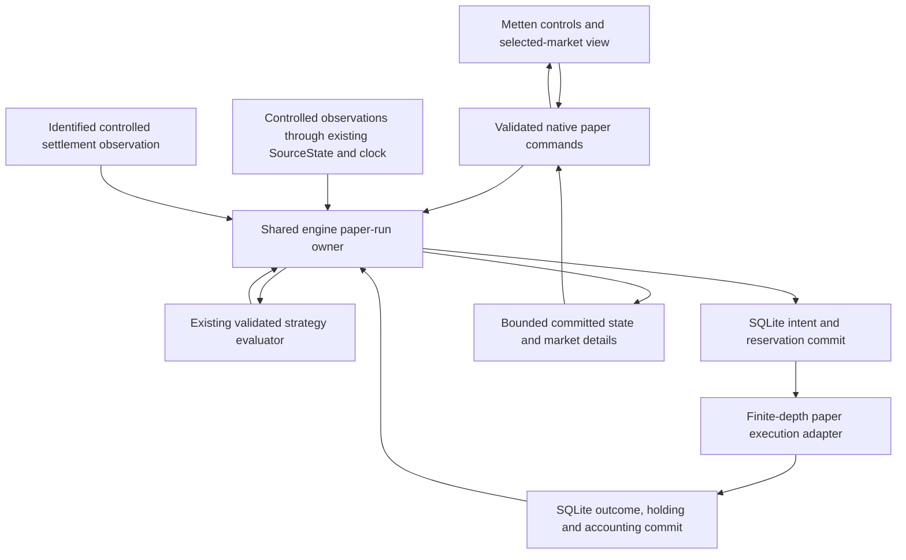

# Issue #6 — First paper purchase through settlement and history

* **Author:** Connor Moulton
* **Status:** Owner-approved behavior; Detailed Implementation passed focused independent recheck; ready for owner implementation authorization; no implementation authorization
* **Date:** 2026-11-18 (refreshed; initial draft 16 November)
* **Tracker:** [GitHub issue #6](https://github.com/moultonpoint/metten/issues/6)

## Overview

BTC15m denotes a Bitcoin market with a 15-minute window. YES and NO are the two contract outcomes defined by that market’s rules; held winning contracts pay $1 and losing contracts pay $0 in this controlled example. See the [domain glossary](../../../GLOSSARY.md).

Deliver the first connected paper-purchase lifecycle in Metten's existing shared Rust engine: begin at an eligible full BTC15m market boundary, evaluate the selected immutable learning-strategy version, validate the fixed run settings and available paper funds, durably record intent, simulate a full fill or zero fill against finite observed quantity, then account for fees and settlement in readable history. Paper execution is an adapter to the same engine, not a separately implemented trading or strategy path. Production purchase submission remains unavailable.

For the owner-approved prototype scope added to #6 on 18 November, connect these lifecycle components using controlled source observations, finite-book evidence, settlement outcomes and clock. This is the first complete controlled paper lifecycle. It does not claim that #5's received production quotes are strategy-usable or introduce a production source-to-purchase connection. Capacity campaigns, collectors and diagnostics were deleted; later performance work belongs to #16 and is not a prerequisite here.

The selected market should explain what happened before asking the user to interpret a graph: whether a purchase occurred, its time and confirmed quantity, price, fees, pending or settled state, and a specific main reason for a skip or failed attempt. Additional retained evidence belongs under View details. A strategy condition being observed is distinct from all purchase checks passing, an attempt is distinct from a fill, and a fill is distinct from settled profit or loss.

The [accepted visual reference](visual-reference.png) shows the preferred hierarchy and brand. Its charts, statements and aggregate metrics illustrate later scope, and its sample numbers are not accounting rules. Use the accepted Metten visual direction for the controls and history this slice actually implements. The prototype is evidence of preferred layout and interaction, not a source of strategy thresholds, fees, simulation rules or financial truth. The UI consumes engine state; illustrative prototype data and unsupported future controls do not become product behavior.

## The Problem

The current foundation can persist controlled session actions and immutable strategy versions and can evaluate supported rules with controlled inputs. It does not yet connect those capabilities into a trustworthy paper purchase, financial outcome and per-market explanation. Seeing a rule signal or a requested action is insufficient evidence that a simulated purchase filled or that its result is settled.

Users need a complete paper workflow whose visible costs, outcomes and reasons agree with durable engine records. Engineering needs controlled inputs and a clock to prove that behavior without account access, purchase endpoints or a second implementation of strategy rules. A convincing chart or a profitable fixture cannot establish live acceptance, future fills or strategy quality.

## Goals

1. **One shared purchase path.** Reuse validated JSON and existing engine evaluation. The shared engine owns settings validation, purchase authorization, request construction, intent/outcome recording and financial truth. Paper simulation supplies execution outcomes through its adapter boundary.
2. **Truthful initial execution.** Support documented finite-depth full-fill and zero-fill outcomes, fees and accounted-for settlement. Do not invent a fill from intent, ignore fees, grant unlimited liquidity or imply that the initial simulator proves live behavior. Partial-fill completion and retries remain later work.
3. **Initial financial protection.** Validate paper funds, requested quantity, permitted prices and worst-case objective loss before the first purchase, using exact money arithmetic. One objective per market; skip an unaffordable objective instead of shrinking it. Necessary recording and pending/uncertain-outcome safeguards remain in force even though later issues deepen recovery and limits.
4. **Faithful run controls.** Go waits for the next full eligible market boundary. Stop after market, Pause purchases now and quit preserve their different effects. Strategy and run settings remain fixed while active. Stopping or reopening does not erase history or imply permission to resume automatically.
5. **Readable market evidence.** Show requested versus confirmed quantity, purchase timing, price, fees, unsettled holdings and settled result, all attached to the actual strategy version/settings and market. Show one specific main outcome/reason with additional available evidence under View details. Distinguish no qualifying rule, unavailable evidence, a purchase blocked by checks, a failed attempt and a confirmed zero fill; do not label unknown data as a false condition or a pending result as a loss.
6. **Meaningful completion evidence.** Exercise the engine's public controls with controlled source/execution observations and clock. Demonstrate a paper walkthrough from Go through a confirmed simulated purchase, fees, settlement and matching history. Include the zero-fill, validation and control boundaries required by the ticket. Complete all five existing acceptance items rather than replacing them with a UI demo.

### Alignment with the existing ticket

| Current #6 acceptance | This draft's commitment |
| --- | --- |
| Shared engine, fixed settings, requests and durable intent/outcomes; paper adapter | Goals 1 and 4 |
| Initial finite-depth full/zero fill, fees and settlement; no invented fill | Goals 2 and 6 |
| Funds, quantity, price, worst-case loss, exact arithmetic, skip rather than resize, one objective | Goal 3 |
| Distinct controls, immutable settings, honest requested/filled/unsettled/settled UI/history, live disabled | Goals 4 and 5; Overview |
| Controlled observations/clock, public engine tests and paper walkthrough; one strategy path | Goals 1 and 6 |

## Non-Goals

- **Changing the tracker scope or prerequisites.** Both #4 and #5 are now closed with delivered source/evidence; this supersedes the earlier open-blocker status. This document does not change any issue, acceptance item or dependency, and plan approval is separate from implementation authorization.
- **An analytics/archive expansion.** Thirty-day historical chart retention, permanent statements containing summarized charts, automated generation, downloads and original/revised statement lifecycle are preserved product ideas from the brainstorm, not additions to #6. Export/backup ownership belongs with #14; chart-retention ownership must be explicitly scoped before implementation. These features are not prerequisites for completing #6.
- **Every prototype view as acceptance.** Comprehensive per-condition chart history, cumulative analytics/participation dashboards and win-percentage reporting are not required by this ticket. Use the accepted visual language for the essential session/outcome experience; do not implement a second evaluator or add a generic reporting framework to reproduce the prototype. Exact current/purchase decision observations needed for truthful #6 explanations remain in scope.
- **Simultaneous independent paper sessions.** That is #13. This slice does not add a multi-session manager or concurrency/capacity promise.
- **Implementing later lifecycle slices.** Partial-fill completion/retries (#7), comprehensive uncertain-purchase recovery (#8), feed-interruption preservation (#9), full daily-limit accounting/resumption (#10), live qualification/transition (#11) and exchange order integration (#12) remain separate. This separation never removes an initial safeguard expressly required by #6 or the accepted product specification.
- **Broad product restyling or new capabilities.** No full #15 branded onboarding rollout, dashboard builder, new strategy inputs/operators, D/F rules, unrelated markets, selling or resting orders. No continuous raw-feed archive or arbitrary backtesting promise.
- **Operational authority or release claims.** No real credentials/accounts, paid sources, security-setting changes, deployment, signing/publication or real-money validation. Paper outcomes do not establish live acceptance or fills.

## Resolved Implementation Inputs

The Detailed Implementation section now fixes the controlled source/book/clock boundary; full-or-zero best-ask model; exact monetary units and pinned fee rounding; transaction/reopen/control behavior; bounded explanation and command shapes; UI subset; and exhaustive file/check inventory. These decisions preserve the approved ticket scope. No required engineering choice is left to prototype values or guessed production source capabilities. Design review and section approval remain outstanding; runtime correctness is unproven until implemented and checked.

## Critical User Journeys

### Start and complete a paper purchase

- **Given:** A supported immutable saved strategy version, valid fixed paper settings, adequate simulated funds and risk allowance, and controlled observations using #5's existing source/evaluator contracts. Live submission is unavailable. The controlled walkthrough is clearly labeled and cannot be mistaken for a run on production data.
- **When:** The user presses Go, required post-Go history becomes ready and the next eligible full market boundary arrives; the strategy then qualifies within that market.
- **Then:** The engine records the run/objective and intent before simulation, records a confirmed full or zero-fill outcome before publishing it as confirmed, and preserves the reason and supporting observations. A full fill remains a holding until a valid settlement result is recorded. History shows price, quantity, fees, payout and exact settled net result; pending settlement is never shown as zero profit or a loss.

### Understand a market without a purchase

- **Given:** The run participates in a market, but no confirmed purchase occurs.
- **When:** The user opens that market.
- **Then:** A concise main explanation names the actual failed rule or purchase check, or identifies a confirmed zero fill, using its recorded time and available evidence. Missing data is reported as unavailable, not a false rule. Additional material reasons are under View details. No chart reconstruction or second rule interpreter supplies historical claims.

### Pause or stop while a market is active

- **Given:** A paper run is active, possibly with a pending attempt or holding.
- **When:** The user chooses Pause purchases now or Stop after this market.
- **Then:** Pause blocks subsequent dispatch admission immediately while outcome/holding monitoring continues. Stop after market allows otherwise valid current-market work but prevents the next market. Neither cancels a confirmed purchase, sells a holding, changes active settings or erases history. A dispatched operation may still complete and must be reported honestly.

### Quit or reopen safely

- **Given:** The app has paper-run records, possibly with an unsettled holding or an interrupted intent/outcome boundary.
- **When:** The user confirms Stop and quit, or the application unexpectedly exits and is reopened.
- **Then:** Normal quit prevents new dispatch, preserves the latest confirmed records and any unresolved state, and explains a failed save rather than silently exiting as saved. Reopen is stopped. Retained intents are not replayed and unknown outcomes are not treated as zero fill. Existing holdings/outcomes remain inspectable; no automatically resumed purchase follows from a restored UI.

## Technical Plan (Architecture)

### 1. Existing contracts and the intended change path

The delivered source baseline is now main `c7b1b4c79d2ca603226f78bcddd143618c3a875e`, the squash merge of [PR #61](https://github.com/moultonpoint/metten/pull/61). This selected worktree remains at older HEAD `868609baffc25f06ecb43d8760e7cdd60f684a68`; it has not been updated or used as evidence of the delivered interfaces. The current foundation's Start/Pause/Advance protocol is explicitly non-trading. It must not silently acquire purchase authority. The source reconciliation below replaces the earlier pre-#5 assumptions.

| Existing owner | Verified current contract | Planned #6 responsibility |
| --- | --- | --- |
| `crates/engine/src/lib.rs`: Engine, request, snapshot, stop_and_save | Bounded controlled-session request queue; immediate effective Pause/Stop; committed history published after SQLite success; stopped reopen | Admit one paper run, coordinate authoritative run/financial state and controls, expose bounded paper state/history, and preserve recording and shutdown invariants |
| `crates/engine/src/strategy.rs`: ValidatedStrategy, Evaluator | RunContext and exact bindings; begin/process_slice; Complete/Pending/Rejected/Stopped/Failed; candidates, checkpoints and coarse option reasons | Reuse existing evaluation/ordering; supply actual objective safeguards; add only bounded evidence needed to substantiate the required explanations |
| `crates/engine/src/sources.rs`: SourceState, SourceEffect, EvidenceStamp | Synchronous normalized source facts; coherent AdvanceBatch, explicit capability limits, current/next readiness, revocation generations and stamps | Reuse this boundary with controlled evidence; capture complete decision dependencies and deliver invalidation before recovery |
| `src-tauri/src/providers/source.rs`: SourceWorker, SourceHandle, SourceView; concrete provider decoders | One read-only native source writer; bounded intake and joined shutdown; latest display projection; financial evaluator is not connected | Preserve the read-only source setup; do not use the coalesced display projection as the paper event stream or add production purchase authority |
| `crates/engine/src/storage.rs`: Recorder | Native-selected locked workspace, transactional migration, durable settings, immutable saved strategies; no financial tables today | Persist run settings, objective/attempt identity, intent, outcome, fees, holdings and settlement through the same workspace owner |
| Proposed `crates/engine/src/paper.rs` | New, not present in assessed source | Concrete finite-depth simulation and its result types; no strategy evaluation, credentials or provider-specific transport |
| `src-tauri/src/main.rs`: Workspace, strategy admission, snapshot/control and begin_quit | Command validation/admission and guarded quit; blocking work off the desktop event thread | Bridge bounded paper commands/reads and coordinate shutdown without owning trading or accounting decisions |
| `src/contract.ts`, `src/main.ts`, checked presentation helper on delivered main | Typed native requests/responses and latest-refresh protection; legacy session UI | Display real paper state, controls, selected-market explanation and receipt using accepted brand/layout; preserve existing strategy and credential behavior |

Expected change route: source/clock observations → engine paper-run owner → existing evaluator and purchase checks → durable intent → concrete paper simulator → durable outcome/accounting → native response/snapshot → concise UI/history. Source/provider formats stay within #5's adapters; strategy-specific branching is forbidden in either adapter or simulator. No separate financial truth lives in Tauri, the UI or a reporting store.

These component responsibilities are made concrete by the file/API inventory in Detailed Implementation; neither this draft nor its inventory authorizes source edits. Add another module only if the concrete ownership/verification need justifies it; do not introduce a general execution plugin platform.

### 2. One serialized paper-run owner

Extend the shared engine with one owner of the active paper run, rather than allowing UI polling or provider callbacks to mutate financial state independently. It holds immutable strategy/settings identity, current market/objective, latest accepted source validity, control admission, the current attempt and confirmed financial facts. Reuse the shared engine's controlled evaluator and source interfaces for this prototype. #5's native runtime owns read-only display intake, not a financial run; no second provider runtime or new asynchronous runtime is needed for the controlled lifecycle. The existing recorder worker is a persistence mechanism; a successful queue insertion is not a completed financial transition.

Logical state distinguishes stopped, collecting required history, waiting for the next full boundary, active market and checking an unresolved purchase. Purchase permission is separate from holdings/settlement monitoring and the requested stop-after-market boundary. These concepts must not be flattened into the foundation's single running Boolean. An unsettled holding may outlive the market's purchase window and must remain tracked when later market admission is considered.

Controls and final purchase admission are serialized with dispatch. Pause/quit must not wait for a full source backlog or long evaluator batch before blocking new attempts. Between bounded processing slices, observe controls and recheck admission before dispatch; do not misuse terminal SliceControl::Stop as a reversible paper-pause switch. Stop-after-market suppresses the next market while retaining valid current-market behavior. Unknown outcomes and failed required recording block subsequent purchases. If required input/queue/work bounds cannot be maintained, stop new purchases with a visible reason; never silently discard required observations or order outcomes.

No new unbounded source queue, historical query or full-ledger clone is introduced. Engine snapshots remain small; selected-market detail/history is read in bounded pages. Implementation must name queue limits, source age limits, cancellation behavior and shutdown ownership using the actual #5 contract and existing evaluator resource guarantees. A passing workload does not establish a universal processing bound.

This diagram is proposed #6 behavior. These paper/financial paths do not exist in the assessed foundation.

### 3. Bind the run to #5's real evidence

Start from an actual saved supported strategy version, not editor text or the prototype's display name. Preserve its exact format/meaning, settings, simulation assumptions and paper identity with the run. Collect the existing evaluator's required post-Go histories and use its established full-boundary behavior: readiness reached exactly at an opening does not authorize that opening. Do not turn a foundation Advance action into a market clock or backdate a late observation to authorize an earlier purchase.

Feed normalized data through the existing RunContext, bound market/contract identities, AdvanceBatch and evaluator begin/process_slice contract. Only a current Complete decision may supply a dispatch candidate; Pending or an older snapshot cannot authorize a purchase. Preserve accepted same-millisecond transaction ordering, coverage, checkpoint latching, market reset and implicit buyable-ask semantics. #6 does not replace the evaluator's clock or continuity rules.

A current ask price is insufficient for finite-depth execution. The delivered Kalshi decoder already reconstructs finite books and emits best-side quantities alongside price, subscription ID, sequence and timing in `wire::Details::Book`. These are received details, not a validated executable-depth contract. `Candidate` contains market, option, side and remaining requested quantity; it contains neither price nor available quantity. For #6, provide bounded controlled book evidence with exact market/contract/side, price, quantity, identity and validity alongside controlled strategy observations. The simulator must not infer available contracts from Candidate, a display snapshot or an acknowledgment. Reuse provider mapping if it later becomes relevant; do not rebuild the decoder or connect production intake as part of this controlled slice.

Settlement needs an identified final market outcome through the engine's settlement boundary. #5 deliberately supplies no authoritative opening/settlement reference mapping or financial settlement service. Use controlled final-outcome fixtures for this slice and label their origin; unavailable settlement remains pending. A contract payout/outcome is distinct from a USD/BTC strategy settlement-reference input. Do not infer either from the last plotted price, a BRTI average or an apparent winning direction. Real-provider settlement integration and any provider/account walkthrough retain their own scope and authorization limits.

### 4. Initial objective and simulation

For this slice, one market objective requests the user's full configured quantity and permits the initial documented full-fill/zero-fill simulation. Before dispatch, the shared owner rechecks rule/side eligibility, deadline, required source validity, price range, funds, worst-case objective cost including fees, existing holdings/reservations and control admission. An objective that cannot fit is skipped, not resized. No objective is submitted twice while its outcome is in flight or unknown.

The paper adapter receives a validated economic request and the corresponding finite book evidence. It returns an explicit terminal full fill or zero fill, or an execution failure/unknown state; it does not decide the strategy or change the quantity. Full-fill pricing must follow the documented supported depth/price policy, never the UI line or an assumed unlimited ask. When available permitted quantity cannot fill the full objective, the initial simulator's documented full/zero treatment is a limitation of this slice, not a claim that real IOC orders cannot partially fill. Do not silently upgrade this into partial-fill completion/retries, which belong to #7.

Fees participate in pre-dispatch reservation and confirmed cost. Detailed Implementation pins the controlled model identity, full-charge reservation and combined cost/fee rounding; the actual simulated charge is recorded separately. The prototype's 58¢ price and20¢ fee are illustrative and cannot supply that model. The pinned controlled assumption is documented below with primary-source support; it does not claim verified live-series/account fee configuration.

Use checked exact arithmetic with explicit units at every boundary. Existing Decimal represents millionths of its declared measurement unit; a six-place value denominated in cents is not automatically integer cents or six-place dollars. Specify conversion, fee precision/rounding, accepted ranges, overflow refusal and database/IPC representation together before implementation. Do not quantize away supported precision or use JavaScript floating-point calculations as financial truth. Detailed Implementation fixes the quantum at 10^-8 USD, with checked intermediates and exact SQLite/IPC representation.

### 5. Durable transitions, accounting and stopped reopen

Reuse Recorder and its single-workspace lock and transaction/migration discipline. Keep legacy controlled-session/strategy records distinct; migration does not invent past paper markets or financial metadata. Use the next schema revision compatible with #5's delivered source, preserving refusal of newer unsupported workspaces. The merged baseline is verified at revision3; Detailed Implementation therefore selects migration3→4, subject to a candidate refresh before coding.

Before simulation, atomically retain the objective/attempt identity, immutable settings references, complete economic request, source/book evidence identity and required reservation/intent. Dispatch is prohibited until that commit is confirmed. After simulation, atomically retain the actual terminal outcome, filled quantity/cost/fees, reservation change and resulting holding before reporting a confirmed fill. Distinguish provider/simulation outcome from success of recording that outcome. A commit failure is not proof that nothing was written.

Settlement updates the same owned holding/market once, with consistent balances and after-fee net result. Duplicate identical outcomes/settlements do not charge or pay twice; conflicting evidence blocks unsafe continuation and is reported. Keep confirmed purchase cost and unsettled exposure visible until settlement. Payout minus recorded purchase cost minus fees defines settled net result; delayed settlement remains tied to the original market-close UTC accounting day. This is initial correct accounting, not implementation of #10's full daily-limit/resumption feature.

On reopen, remain stopped and load retained facts. Never replay an intent into a new paper purchase, infer an empty account from an unreadable record, or classify an interrupted intent as zero fill. The first slice must preserve and block on unresolved states even though #8 owns broader reconciliation and crash-injection acceptance. If automated reconciliation is unavailable, expose the preserved unresolved state rather than adding a bypass/reset. Do not rely on a client ID being reusable as exchange deduplication; live submission does not exist in this slice.

Normal quit first blocks new paper admission, then lets owned work reach a recorded outcome or an explicitly preserved unresolved boundary. It must not wait for provider/engine completion while holding a credential lock that completion requires. Integrate with existing native strategy/credential admission and saved-stop behavior; a failed required save keeps the app open with a concrete retry reason. Detailed Implementation fixes the paper fence, playback/source join and persistence order; credential locks are released before engine waits.

### 6. Commands, explanation evidence and UI

Add an explicitly paper-only bounded command/read capability through Engine and the native bridge. The request family needs start with a saved version/settings, Pause purchases now, Stop after market, current paper state, history and selected-market detail; Detailed Implementation specifies the operations, bounds and file inventory. Preserve the legacy controlled-session protocol and strategy/credential contracts. Reject unknown fields, malformed IDs, unsupported modes and unreasonable input sizes before cloning or work admission. Return finite sanitized failures; never send raw provider/database diagnostics, credentials or arbitrary paths through the UI.

Admission and recorded completion remain separate in responses and presentation. The UI must not optimistically turn an accepted start into an active market, a recorded intent into a fill or a pending holding into settled P&L. Extend current latest-refresh protection and pending/quit controls through the real shared UI harness on delivered main. The renderer never calculates rule truth, financial balances or settlement results independently.

Current Decision/LeafResult/RuleError outputs provide candidates, checkpoint observations, option paths and broad reasons. They do not expose every numeric comparison requested by the concept. Extend the authoritative evaluator/admission result only for evidence needed by the #6 explanation: rule/option identity, evaluated time/order, source/unit/side, relevant observed/required value or unavailability, actual purchase block and confirmed execution/financial outcome. Account for added memory/work in existing evaluator guarantees and focused tests. Do not build an unrestricted per-tick trace or a second interpreter for presentation.

While active, show the current waiting/blocking reason. A completed market leads with confirmed purchase/attempt facts. A confirmed zero-fill attempt cannot disappear behind a later deadline message. For an unpurchased market, name the recorded rule/check and supporting observation; when several apply, show one stable main reason and the others under View details without claiming it was the sole cause. A last observed value is labeled with its time, not presented as a proven whole-market maximum. Detailed Implementation specifies the deterministic reason-selection table and bounded evidence schema; their meaningful checks are part of implementation acceptance.

Use the accepted layout/brand for the real controls, outcome/receipt and market history in this ticket. Do not port the prototype bundle or introduce React/UI SDK/Inter packages into production merely because the prototype used them; any package/font change requires an explicit current implementation need and its normal review. Comprehensive price-chart retention, condition-history visualization, statements and aggregate analytics remain outside this draft's acceptance. Unsupported prototype controls are omitted rather than enabled with synthetic data in the actual app.

### 7. Verification boundaries

Primary checks use the public Engine paper capability with controlled source, book, execution and clock inputs, backed by real temporary SQLite where persistence matters. Cover full/zero fill, finite quantity and price constraints, funds/worst-case refusal, exact fees/payout, duplicate/conflicting outcomes, failed intent/outcome/settlement commits, stopped reopen, boundary readiness and each control's dispatch effects. Include mid-slice Pause/quit and stale-read presentation races. Deterministic fixtures must traverse the same lifecycle as the delivered paper adapter, not a stand-alone strategy test or the UI prototype.

Focused native/IPC and packaged checks cover strict decoding, command admission, guarded quit, real storage and the first controlled paper walkthrough without real credentials or live endpoints. Use unattended native/headless/process verification; a desktop GUI walkthrough is optional unless Connor explicitly requests it for this task. Reuse unrelated credential/strategy evidence only within its actual unchanged source limits. Browser checks use the dedicated headless shell/disposable profile rule. Preserve published lint, compiler, ordinary behavior, packaging and CI checks on the implementation candidate. Reuse unchanged evaluator full-hour evidence where applicable; do not introduce capacity calibration, long qualification or collector campaigns under #6. No application test was run for this document-only refresh.

The Detailed Implementation section resolves the former contract questions and maps them to specific checks. Its review must assess those contracts before implementation starts; no passing runtime or independent design-review result is implied.

## Alternatives Considered

This section records the choices already made in the approved brainstorm alternatives, together with the approved ticket boundaries. It does not assert that competing implementations have been benchmarked or independently proven. The owner's approval covers intended behavior/scope; engineering review and implementation checks remain necessary.

### Generic outcome labels as the complete explanation

- **Benefit:** Short copy and a small set of display categories.
- **Cost:** “Conditions never met” does not identify the rule, required value or missing observation. It cannot answer the user's question about why a purchase did not happen and can misrepresent unavailable evidence as a failed condition.
- **Reason for rejection:** Generic outcome labels cannot identify the actual failed rule or missing observation; the summary must give a specific main explanation. Internal categories may remain useful, but they are not sufficient user-facing evidence.
- **Selected direction:** One concise factual outcome/reason, with the actual rule/check and available supporting evidence; additional details remain accessible.

### Put every blocker in the market summary

- **Benefit:** Exposes many facts immediately without a further selection.
- **Cost:** Competing reasons obscure the market's main outcome and can imply that every blocker applied at the same time. The current waiting reason and the completed market's story also have different time scopes.
- **Reason for rejection:** One main reason keeps the outcome readable; additional retained reasons belong under View details.
- **Selected direction:** Lead with confirmed purchase/attempt facts or a specific reason for no purchase, retaining time-bound material changes in details. Detailed Implementation specifies the deterministic selection table; this choice does not allow inventing a sole cause.

### Count each qualifying update as another opportunity

- **Benefit:** Shows how frequently the evaluator reported a qualifying state.
- **Cost:** A rule remaining true across many updates can inflate an opportunity count without representing another market or purchase. Feed frequency and observation batching can distort the apparent ratio.
- **Reason for rejection:** Count each market once so repeated updates cannot inflate participation.
- **Selected direction:** Keep stable market identity in #6 records. Comprehensive participation ratios remain outside this ticket; any later metric must derive from recorded market facts with explicit populations, not raw update counts.

### Give every condition its own chart lane by default

- **Benefit:** Can show persistent truth intervals and multiple condition changes without overlapping markers.
- **Cost:** Adds visual height and competing tracks, particularly for nested rules, without establishing that each track answers a current user question.
- **Disposition:** Selectable condition dots preserve a compact baseline without adding a lane for every rule. The accepted prototype later adds a compact chronological checkpoint/qualification/purchase sequence, which is distinct from a full chart lane for every rule.
- **Selected direction:** Preserve concise progressive explanation and the accepted UI language for the #6 slice. Detailed condition-history charting is not made a prerequisite here; no blanket prohibition on future visual refinement follows.

### Delete statements when interactive charts expire

- **Benefit:** Reduces retained archive growth and cleanup complexity.
- **Cost:** Removes history the author wants to inspect later, including summarized price context and the exact information known when a statement was issued.
- **Reason for rejection:** Retain statements, including summarized price charts, until explicit deletion, and preserve originals with clearly labeled revisions for late settlement; automatic deletion would lose required historical context.
- **Scope disposition:** This remains a recorded future product decision. #6 retains its required market/financial history but does not implement statement generation, expiry, permanent chart archives or downloads. Later archive work must establish permissions, space usage, deletion and failure behavior rather than imply fixed storage cost.

### Retain the full raw feed to enable exact replay

- **Benefit:** Could supply more observations for later investigation than a summarized chart, subject to completeness and compatible interpretation.
- **Cost:** Expands retained data, source-permission obligations and replay complexity. Recording a feed does not by itself prove that a historical decision can be reproduced under future software.
- **Reason for exclusion:** The accepted product contract excludes continuous raw-feed storage; no authority was given to change it. This is a binding scope boundary, not an alternative the draft may choose for convenience.
- **Selected direction:** Retain the exact decision/financial evidence required by #6. Later summarized-chart storage is separately scoped and cannot silently become a raw archive.

### Promise arbitrary strategy backtesting from statements

- **Benefit:** Would let users ask broader counterfactual strategy questions using retained downloads.
- **Cost:** A statement may omit price paths, depth, required source history or temporal observations needed to evaluate a different strategy. Exact old financial arithmetic and inspection of recorded decisions are narrower guarantees than replaying arbitrary rules.
- **Reason for exclusion:** The brainstorm explicitly makes no full replay or arbitrary backtesting promise. No independently executable archive format has been selected or tested.
- **Scope disposition:** Future statements must document evidence limits. #6 neither creates that export nor expands the evaluator to run retrospective analyses.

### Binding architecture and delivery constraints

A second strategy implementation, financial truth calculated in the renderer, or a simulator granted live purchase/account access are not open alternatives: they conflict with #6's acceptance and ADR 0001. Likewise, implementing every view in the broader prototype under #6 would contradict the approved Non-Goals. These constraints do not substitute for evaluating legitimate technical options when their actual tradeoffs are known.

No new product-scope decision is introduced by Alternatives. Detailed Implementation below supplies the engineering mechanisms for the previously approved behavior, including the now-delivered source boundary and controlled execution assumptions.

## Detailed Implementation

**Section state:** Owner-approved proposal with A1–A3 independently rechecked and closed, based on main `c7b1b4c79d2ca603226f78bcddd143618c3a875e`. On the fresh tracker read, both #4 and #5 are closed; #5's completion comment links merged source, tested-source equality and passing hosted evidence. This removes the dependency gap recorded during the earlier refresh. It does not authorize implementation. The decisions below resolve the former engineering questions; owner review concerns the promised behavior/scope, with engineering responsible for correctness.

The implementation is one controlled paper lifecycle, not a live-price paper service. Ordinary app use must call this **Controlled paper example · Synthetic data · Accelerated clock**. Production Sources remains a separate read-only feature. No account, network or credential operation is needed for the paper example. The implementation must not advertise a strategy running on the real market, live eligibility, arbitrary backtesting or unlimited run duration.

### 1. Pin the candidate and keep the ownership path short

Implement on a candidate containing the delivered merge, rather than copying missing #5 files into this old checkout. Refresh published guidance and tracker state at start and delivery; preserve the owner-requested Unslop skill and unrelated work. Use the existing engine thread, eight-slot admission queue, Recorder/workspace lock and evaluator. Add one concrete engine module, `crates/engine/src/paper.rs`, for paper types, lifecycle, exact financial operations and finite simulation. A separate native `src-tauri/src/paper.rs` owns only command admission, controlled playback and the packaged headless check. Neither is a strategy interpreter or a provider framework.

The route is: selected immutable saved version and fixed settings → engine-owned SourceState and existing Evaluator → current decision and shared checks → committed intent/reservation → concrete paper simulation → committed outcome/holding → identified settlement → bounded committed history. The native playback adapter supplies controlled observations; it never chooses a purchase side or computes financial results.

### 2. Fix the controlled input and run contract

Add one documented fixture, `examples/paper-learning-scenario.json`, with a format/revision, synthetic origin, exact BTC15m identities, two nonoverlapping 900000-ms market descriptors, ordered virtual-time observations, finite best asks/quantities and identified final outcomes. Native playback embeds this fixture at build time; the renderer cannot upload observations, settlement, a scenario path or an executable strategy. Tests may construct additional controlled inputs through the public engine boundary. No code branches on the learning strategy's name.

Use an initial current market opening at -899000 ms and closing at 1000 ms relative to Go; the next market is [1000, 901000). Prepare and verify the next market before 1000 ms. Supply YES ask 35¢ and NO ask 70¢ during the early checkpoint interval, then YES 80¢ and NO 25¢ during the purchase interval. Each book includes explicit finite quantity and identity. The [unchanged learning strategy](../../../examples/learning.json) latches the side meeting its early checkpoint, then considers the opposite side during its purchase interval. In these controlled observations it therefore remembers YES and can buy NO; the adapter does not encode that conclusion. The final fixture result is NO. The fixture is a mechanics example, not a profitability claim.

The public engine input is a typed `PaperInput` with run ID, monotonically increasing input ordinal, virtual monotonic time, and either a source event, a finite book observation, a clock advance or a final settlement. Source events use existing SourceState types/captured tokens. Engine construction supplies controlled capabilities; an event cannot grant its own capability. Receipt/accepted/frontier/received-through clocks retain #5's ordering. SourceEffect batches are delivered coherently and fully drained before another ordinary source event is admitted. No watch/latest-view polling is used as an event stream.

Books name exact market/contract/side, ask in engine contract-cents Decimal, available quantity in millionths of a contract, observation ID, source generation, accepted time and valid-through time. Capture complete rule/implicit-ask dependencies plus book identity; a stamp grants no freshness by itself. Require matching identities, current generation, validity through dispatch and a completed evaluator frontier.

Before committing intent, require the finite book and completed decision to agree on the exact market/contract/side, source binding, accepted source transaction/observation identity and exact ask value. A SourceState stamp certifies generations, not quote identity or value. Capture the evaluated ask and its accepted identity in the decision witness; join the book to that witness rather than to Candidate alone.

A relevant source-ask or book replacement obsoletes dispatch permission until both views are coherent and the evaluator completes against the corresponding evidence. If either input arrives first, wait without recording intent or simulating a fill; reject conflicting identity/value pairs and retain a named evidence-mismatch reason. Missing, stale, inconsistent or refused evidence blocks purchases; it is never a false comparison. Declared leases/quiet intervals are controlled test facts, not production guarantees.

Playback supports the fixture's ask-only, zero-lookback input capabilities; other requirements get a finite start error identifying the unsupported inputs, without changing strategy validation or format meaning.

The example runs at a labeled 20× virtual clock: one native timer wake per 50 ms advances by at most 1000 virtual ms, in event order. There is one owned playback task and at most one outstanding engine input; it awaits completion before advancing. Tests/headless checks advance the same clock directly without sleeps. Native SystemTime supplies the UTC Go anchor as checked epoch milliseconds; virtual market UTC is anchor plus signed offset, never provider timestamp ordering. Store the market-close UTC day by integer division into 86400000-ms days. The finite example stops new market admission when its prepared markets end; it does not invent an unbounded market generator. Timer delay slows playback rather than skipping observations. Reopening never restarts the timer automatically.

Fixed settings are saved version ID, whole contracts per market, inclusive minimum/maximum price in contract cents, starting paper balance and the pinned simulation/fee revision. Accept quantity 1–1000000, starting balance greater than zero and at most $1000000, and 0 ≤ minimum ≤ maximum ≤ 100¢. These are validation limits, not a measured capacity promise. One foreground paper run is admitted; previous pending holdings remain visible and must settle before a new example starts. One objective and at most one dispatched attempt per market belong to #6. A proposal canceled before dispatch consumes no execution attempt; a later explicit Resume may create a newly validated proposal, but never retry a dispatched full/zero/unknown attempt. Daily thresholds/automatic next-day resumption remain #10; do not expose working-looking daily controls in this slice. Basic loss allowance is the fully funded paper account described below, with no borrowing or silent resizing.

### 2.1. Bounded input retries and durable receipts (A1)

Only the latest **completed** ordinary input can be retried in a still-open run context. Ordinals start at1 and increase by exactly1 within signed64-bit positive range; exhaustion fences input with resource_limit before incrementing; no archive of earlier inputs is required. Check the run/context token and admission state first. Given last completed ordinal n: n with identical canonical content returns its recorded completion revision/result without applying source/evaluator work or any financial transaction; n with different content fences purchases and reports input_conflict; any positive ordinal below n is stale_input even if its content was once identical; above n+1 is input_gap and fences purchases. n+1 is new work only when no input is pending. Stale/gap/conflict inputs do not modify the retained completed receipt. After quit/reopen all ordinary input submissions, including identical retries, return stopped_context; inspection and the separate settlement-only command remain available.

Keep one last-completed receipt and one optional pending receipt in paper_runs. Each retains ordinal, virtual time and canonical content, plus the completed receipt's finite result code/committed revision and last evaluated-through time. Canonical content is at most64KiB: a versioned fixed-field-order encoding of the typed input, normalized exact integer/decimal values, exact source IDs, the paper owner’s captured input-context generation, all clock/validity fields and payload fields. The paper owner issues that context generation and increments it when source invalidation/replacement retires ingress work; existing opaque SourceState tokens are checked during live admission and never serialized or introspected by the receipt encoder. No hash-only equality, raw provider frame, memory address or opaque Rust object serialization is used. Equal semantic typed inputs have identical bytes; distinct side/price/quantity/clock/generation content compares unequal. Reject oversized input before retaining or queueing it. This stays inside the existing paper module and serde_json dependency.

Before applying a new input, transaction B0 commits its pending receipt while leaving n unchanged. Failure means no source/evaluator work or simulation starts. Deliver its source changes coherently, complete bounded evaluation, and use the already specified intent/outcome transactions C/D when needed. Only after all required effects have confirmed durable outcomes does transaction B1 atomically replace the completed receipt, set n to the new ordinal, update virtual_frontier_ms and last_evaluated_through_ms, store the finite completion result/revision and clear pending. Publish completion only after B1 confirmation/read-back. A duplicate of an in-process pending ordinal returns busy; an unconfirmed B0/B1 or financial commit fences admission and is inspected under its original identity, never executed again merely because the reply was lost. A B1 confirmation recovered by exact durable receipt equality may return the recorded completion without reapplication.

On reopen, preserve a pending receipt as interrupted evidence and keep its ordinary source/evaluator context stopped. Do not replay it, promote it to completed, or infer zero fill. An associated intent without a confirmed terminal outcome remains unresolved and blocks new runs. If no financial outcome is unknown, already confirmed holdings may use the settlement-only path; after they settle, the stopped/interrupted context itself does not prohibit an explicitly requested new example with a new start UUID. Keep its interrupted receipt and history. This distinguishes discarded in-memory strategy progress from unknown money effects; it does not implement general #8 recovery.

### 3. Specify exact money, fees and the finite fill model

Use signed 64-bit integer amounts in **10^-8 USD** for balances, costs, fees, reservations, payouts and net result; use checked i128 intermediates. This preserves existing six-place contract-cents exactly: Decimal millionths of a cent maps one-for-one to these units. One dollar is 100000000 units. Requested quantities are whole unsigned integers; finite book quantities retain six decimal places and are never rounded up to grant liquidity. Reject malformed, negative, out-of-range or overflowing input before committing intent. Store integer amounts in SQLite; send IDs, amounts, quantities, counters and clock values as canonical decimal strings over IPC. The UI formats strings/BigInt and never calculates money with Number.

Pin fee model `controlled_general_taker_2026_07_07_m1`: multiplier 1, immediately matched taker formula 0.07 × quantity × P × (1−P), where P is dollar price. Round **cost plus unrounded fee** upward to a centicent ($0.0001), then subtract exact cost to obtain the charged fee. Use rational integer arithmetic and ceiling division, not intermediate rounding. The [official schedule effective 7 July 2026](https://kalshi.com/docs/kalshi-fee-schedule.pdf), checked 18 November, states this combined rounding and no settlement fee. The [current fee page](https://kalshi.com/fee-schedule) distinguishes standard and nonstandard multipliers. This is a pinned controlled assumption, not verified KXBTC15M/account-specific live fee configuration. Persist the revision and multiplier with every run/attempt; a later fee revision cannot reinterpret old results. No maker fees, rebates, deposits or withdrawal costs are simulated.

The initial model uses one observed best ask, with no sweeping deeper levels, partial fills, retries or latency prediction. The engine constructs an economic request at the current eligible ask, within both strategy conditions and the configured range. It locks the accepted book observation for the deterministic attempt. If available quantity is at least the full requested quantity, return one full fill at that ask; otherwise return confirmed zero fill with the actual available quantity and `insufficient_quantity`. A zero fill charges no fee. Missing/invalid evidence is a blocked request, not a zero fill. This full-or-zero simplification is disclosed; it is not a claim about real IOC partial-fill behavior.

Reserve the **whole exact cost plus rounded fee** before simulation. Because this frozen-book model executes only at the validated request price, that amount is both its maximum debit and worst-case loss; a loss can consume the entire charge. Available funds = committed cash minus in-flight reservations. A fill debits cost/fee once and releases its reservation; an unsettled holding is already paid for and must not be subtracted twice. A zero fill/canceled-before-dispatch proposal releases the reservation without debit. Recheck funds and loss funding together immediately before intent; skip rather than reduce quantity if the whole charge cannot fit. The starting balance is the initial funded loss allowance; settled payouts can fund later objectives. This is basic funded paper accounting, not #10's daily risk policy.

Settlement accepts only an identified final binary outcome for the exact synthetic market, at or after close. Pay $1 per held winning contract and zero for losing contracts, with no settlement fee under this revision. Net settled result = payout − purchase cost − purchase fee. “Winning side” and positive net result are separate fields. Unsettled holdings have no settled net result. Example: ten contracts at 25¢ cost $2.50, fee $0.1313, total debit $2.6313; a winning payout is $10 and net +$7.3687, while a losing payout is $0 and net −$2.6313. Starting at $100 yields cash $97.3687 while unsettled and $107.3687 after a win. Display enough precision to reproduce these amounts; do not round a receipt silently to two decimals.

### 4. Serialize controls, evaluation and dispatch

Extend the existing engine request operation to carry typed paper work and typed completion replies; keep legacy Action/Snapshot behavior intact. The existing worker owns mutable PaperRun/Evaluator/SourceState and serializes recording. Globally admit at most one outstanding paper input, including through the public engine API; refuse another before cloning/queueing. The driver captures an opaque run/source-generation token before producing that input, and the engine rejects retired tokens rather than reacquiring identities at application time. SourceState limits remain unchanged. Expose Engine paper request/read methods and a native-only typed controlled-input method; no controlled-input method is registered as IPC. Native commands execute off the desktop event thread. Cache only a small committed paper summary under Shared; never hold that lock during SQLite or evaluator work. Detail reads lock Recorder only and return bounded pages; no native/provider callback mutates financial state.

Pause and quit synchronously revoke a paper admission generation before waiting for work/queue space. Stop-after-market synchronously records the no-next-market fence; its durable completion follows through the worker. Final dispatch checks these fences while marking the attempt dispatched under the same short lock. If the control fence wins, commit `canceled_before_dispatch` and release the reservation; a later Resume requires a fresh completed decision/book and a new proposal identity rather than reusing its old economics; if dispatch wins, finish and record its outcome while honoring the fence for all subsequent work. A late start/input completion cannot restore a revoked permission. A full queue rejects admission with Busy; the effective pause/quit fence still holds. Neither timer nor UI retries mutations automatically.

Process the evaluator in its existing bounded slices. Between slices inspect paper fences; do not convert reversible Pause into terminal SliceControl::Stop. Drain an admitted coherent source batch before using its result; only Complete with current dependencies can create a request. No ordinary input is accepted behind a Pending batch. For explicit source invalidation during evaluation, revoke dispatch immediately and deliver the returned revocation before fresh initialization; Busy misuse/undeliverable revocation stops the controlled context. Preserve all existing slice/memory accounting rather than inventing a new throughput threshold.

| State/control | Required behavior |
| --- | --- |
| Go from stopped | Validate version/settings/capabilities, commit a new run, begin collection, and wait for a strictly ready next full boundary. Never enter the already-open market. |
| Active window | Evaluate current valid evidence; one full/zero attempt at most; after a terminal attempt, no second attempt in this market. |
| Pause purchases now | Revoke dispatch immediately; continue source evaluation, checkpoint retention, outcome and settlement monitoring. Settings remain fixed. |
| Resume purchases | Explicit same-run action; recheck current inputs, deadline, objective and unresolved state. It cannot erase a prior attempt or replay a missed purchase. |
| Stop after market | Finish permitted current-market work, then block the next market. Before the first eligible boundary it stops without entering one. Keep holding monitoring until settlement. |
| End of fixture/market | Finalize the market summary once; stop admission. Pending settlement remains visibly pending, not a loss or a fabricated skip. |
| Quit | Fence paper dispatch before source/credential waits; stop/join playback; preserve outcomes or a durable unresolved boundary; call the existing saved-stop guard. A failed required save keeps the app open. |
| Reopen | Load committed facts, mark run stopped, never replay intent or start playback. An unresolved intent blocks new purchase runs. An explicit check-settlement action may deliver only remaining identified fixture settlements for already held contracts. |

Native quit uses the existing total source-shutdown deadline, also bounding playback join. It first fences paper admission and stops new native mutations, then cancels/joins playback and existing source ownership, waits for admitted strategy/credential operations, releases their locks, and asks Engine to save/stop. No credential lock is held while awaiting engine work. Timeout retains task ownership and cancels quit; Drop does not detach work or claim a saved exit. The paper worker does not need Keychain or network completion.

### 4.1. Settlement-only checks after stopped reopen (A2)

At run creation persist a bounded synthetic settlement manifest (at most2 market entries/16KiB) from the trusted embedded scenario, in the same transaction as its immutable scenario revision and prepared market rows. Each entry stores exact source market/contract IDs, market close offset, final outcome ID, winning side and outcome-available virtual time, which must be at or after close. These are declared synthetic facts, not a forecast or an exchange-confirmed outcome. They remain unavailable to ordinary financial presentation until delivered under the scenario clock. The renderer cannot supply/edit them. Persisting them makes an old run independent of a later binary changing or removing its embedded fixture. A scenario without a final entry leaves the corresponding holding pending; never invent a result.

Persist virtual_frontier_ms separately from the evaluator's last_evaluated_through_ms; initialize both to0. Ordinary completed inputs advance the former monotonically in B1. Reopening loads those persisted times but starts neither timer nor evaluator. check_settlement is admitted only for a stopped run with no pending playback/task; paused/active runs receive run_active. It fences purchase admission and does not deliver an ordinary PaperInput or consume its ordinal. If a purchase intent is unresolved, return unresolved without settlement or clock advancement. An interrupted source input with no unknown financial outcome does not itself prevent settlement of confirmed holdings.

Reconstruct the settlement cursor from confirmed held markets lacking a paper_settlements row, joined to the persisted manifest; no separate mutable cursor is needed. Visit entries in (outcome-available time, paper_market_id) order. For each known eligible entry, choose target virtual time = max(current persisted virtual frontier, market close, manifest outcome-available time). In the existing transaction E atomically persist the identified settlement, exact payout/net and resulting cash, and that target frontier; actual recorded_at remains the actual UTC recording time. No source observation, checkpoint, purchase decision or intent is replayed, and last_evaluated_through_ms stays unchanged. The engine remains stopped. The synthetic outcome's effective virtual time and actual recording time are distinct fields in detail/history, and the close-day assignment remains anchored to the original virtual market close.

The UI describes the explicit action as resolving the remaining synthetic outcome while purchases remain stopped. It advances the controlled settlement clock, not wall time. A pre-close reopened holding therefore stays pending until this explicit action; a successful action records its known manifest result immediately. Repeated/concurrent checks serialize and return already committed facts without a second payout or frontier regression. No holding or no final manifest entry means no time advancement/payment and an honest no-holding/pending response. A failed or ambiguous E commit publishes neither a new balance nor a new frontier; inspect its settlement identity before retry. For the ten-contract25¢ winning example, a pre-close quit/reopen shows cash$97.3687 and pending; check_settlement changes it once to cash$107.3687/net+$7.3687 and frontier at least901000ms (and at least the manifest availability time), with unchanged stopped purchase/evaluator state.

### 5. Add one transactional financial record, preserving older workspaces

Migrate schema 3 → 4 inside Recorder's existing migration transaction; fail on versions above 4. Preserve existing settings/session/strategy rows and verified WAL/FULL/fullfsync settings. No legacy session event is converted into a financial event. Enable and test foreign-key enforcement for the new relations.

Use five STRICT tables, with explicit constrained integer columns for money/quantities and bounded versioned JSON only for descriptive evidence:

| Table | Identity and retained facts |
| --- | --- |
| `paper_runs` | Integer ID; unique start request UUID; saved strategy FK/format/meaning; immutable settings/model/scenario revision; UTC Go time; control state; last-completed and optional pending canonical input receipts/result revision; virtual frontier and last evaluator frontier; bounded immutable synthetic settlement manifest; committed cash/reservation totals; stop/error state. |
| `paper_markets` | Integer paper_market_id primary key; unique(run_id, source_market_id) and unique(run_id, paper_market_id); exact source_market_id/series/contract and UTC open/close; unique objective; participation/qualification facts; current/final main reason, evidence revision and summary; close-day identity. |
| `paper_attempts` | Run/paper_market_id foreign key plus monotone proposal ordinal; unique partial index permits at most one row with a dispatch time per market; request/side/quantity/price; complete source/book identity; intent time; reservation; dispatch state; terminal full/zero/canceled/unknown state; confirmed fill, exact cost/fee and outcome identity. |
| `paper_settlements` | Unique run/paper_market_id foreign key; final outcome identity/revision; winning side; receipt time; held quantity; payout/net and original close-day identity. No update that overwrites a conflicting result. |
| `paper_evidence` | Run/paper_market_id foreign key plus stable rule/check/side/reason key; first/last time/transaction, repetition count, latest exact witness and retained first qualification/block witness. Checkpoint latches and confirmed financial facts retain their original times. |

### 5.1. Source identity versus paper row identity (A3)

paper_markets.paper_market_id is an INTEGER PRIMARY KEY, exposed as a canonical positive decimal string. Seed both prepared market rows in run-creation transaction A with participated=false; only actual eligible boundary participation changes that flag. A prepared/displayed row alone never counts as a participating market. The exact opaque source_market_id is stored separately, unique with run_id; enforce the existing source contract's identity bounds and exact comparisons with no normalization or numeric parsing. Engine RunContext, SourceState, binding scopes and evaluator continue using source_market_id/contract_id unchanged. Source strings such as KXBTC15M-PAPER-NEXT are not IPC row IDs.

Use paper_market_id in paper_attempts/paper_settlements/paper_evidence foreign keys, uniqueness/indexes, UI selection and market/evidence command fields. Each child has a composite foreign key (run_id, paper_market_id) to paper_markets' unique pair, so a row from another run is not addressable with a mismatched run ID. Keep the at-most-one-dispatched-attempt partial unique index on paper_market_id; proposal identity is (paper_market_id, proposal ordinal). Resolve a source event or manifest entry through unique(run_id, source_market_id) and verify its exact contract/series before updating the numeric row. Missing/mismatched mapping blocks input; never attach to a similarly named or current displayed market.

Snapshot current-market references and every history/detail/evidence response use the explicit field paper_market_id; market summary/detail additionally returns source_market_id, source_contract_id and series_id as bounded literal strings for display/provenance. market/evidence requests take run_id and paper_market_id, not a generic market_id. History is ordered by descending paper_market_id, filtered by run where requested, with before_paper_market_id as its exclusive cursor; prepared/unparticipated rows are not market-history results. Evidence rows have INTEGER PRIMARY KEY evidence_id, ordered descending with exclusive before_evidence_id cursor, constrained to the requested run/paper_market_id. All numeric IDs/cursors stay decimal strings. Original market-close/event times determine chronology shown to the user; row ordering is the stable paging order. The two source identities in different runs map to different paper rows and never share accounting.

The database enforces uniqueness and basic nonnegative/range/state checks. Recorder's typed transactions enforce cross-row balances; re-read and validate them on reopen. Never trust JSON as executable replay instructions. Run settings/identities and committed proposal economics are immutable. A canceled-before-dispatch proposal remains recorded and cannot be rewritten into a later request; only a newly validated proposal may replace its opportunity to dispatch. A dispatched attempt, including zero fill, is never retried here. History stays until separately authorized removal; there is no purge/export/statement implementation here.

The transactions are: (A) run creation, immutable manifest and prepared market identity rows; (B0/B1) pending/completed input receipts as specified in2.1; (B) market/objective creation and compact decision changes; (C) intent plus full reservation; (D) terminal outcome, holding facts, reservation release and cash debit; (E) settlement plus payout, net result and summary; (F) control/stopped/unresolved boundary. Publish confirmation only after commit/read-back. A queued operation is not a confirmed financial transition.

Identical repeated start UUID/settings returns the same run; conflicting reuse is rejected. Ordinary input equality, stale/gap handling, pending state and stopped-reopen refusal use only the bounded receipt contract in2.1; settlement-only operations use4.1 and do not reuse those input ordinals. An outcome is accepted only for its committed proposal/dispatch identity; an identical outcome/settlement identity is a no-op; a conflicting final result stops new purchases and preserves both the prior confirmed fact and conflict evidence. Revised statement/settlement correction workflows remain outside this slice.

After an ambiguous commit, do not blindly execute or pay again: inspect the durable operation identity and exact record. If confirmed, publish it once; if not confirmable, block with unresolved state. An interrupted committed intent is not zero fill and is not resimulated on reopen. Save failures retain the last confirmed UI state, show the attempted transition as unconfirmed and fence dispatch. Retrying quit can persist the same known result or explicit unresolved boundary under its original identity; it cannot clear a financial error merely by appending a legacy stopped event. Broader automated recovery remains #8.

### 6. Retain concise evidence without a second evaluator

Extend the existing evaluator's completed result with pre-admission rule qualification and bounded witnesses produced from the same evaluation, before objective/price/funds gates. Read the evaluator’s cached truth/value/observation state; do not reevaluate comparisons solely for presentation. Do not infer qualification from Candidate: current choose applies safeguards before constructing it. Preserve existing winner ordering and RuleError/LeafResult semantics. For each displayed witness retain option/checkpoint ID, condition path, side, truth/unavailable state, observed versus required values/units, source binding, evaluation time and transaction/observation identity. For compound expressions record the decisive branch and its parent relation; never describe one failed OR branch as proof that every alternative failed.

Return one required primary witness and up to 20 additional witnesses per decision, with explicit `more_evidence` when capped. Bound witness paths/IDs by existing grammar limits and each serialized witness to 2048 bytes. Use existing compilation/output allocation and fixed-work charging for this additional storage/traversal, including Pending/Stop continuation. Refuse over-budget output before it could authorize a purchase; never truncate away the main reason or financial facts. Tests must cover the actual maximum and changed resource accounting; ordinary passing fixtures alone are not a bound.

Persist changes to material truth/reason/qualification/checkpoint states, not every timer tick. Repeated identical waits update first/last/count and latest witness. Keep each main reason's first/last witness and first qualification/block witness; this is compact explanatory evidence, not a complete condition timeline. Limit a market to 4096 distinct evidence keys; on exhaustion stop new purchases and retain `resource_limit`, without deleting earlier facts. Query evidence in pages of 20 rather than loading the ledger. If additional details were not retained, say so. No line, dot, extrema or inferred continuous interval is fabricated from this sparse record.

For a running market show the current reason; for a completed market apply this deterministic precedence:

| Priority | Main outcome/reason |
| --- | --- |
| 1 | Unresolved/conflicting purchase or recording state: name what is unconfirmed, preserving all previously confirmed receipt facts. |
| 2 | Confirmed full fill: quantity/side/time/price/fee, then pending settlement or exact payout/net. |
| 3 | Confirmed zero fill: requested versus available quantity, attempt time and no-fill reason; later expiry cannot hide it. |
| 4 | Explicit cancellation before dispatch: name Pause/quit/source revocation and its time; do not call it an exchange no fill. |
| 5 | Rules qualified, purchase blocked: earliest recorded qualified-but-blocked event, then source/recording/control safety, insufficient funded allowance, configured price, in that order for simultaneous reasons. |
| 6 | No rule qualification established: unavailable required evidence first; otherwise first purchase option in JSON order with its decisive failed check, observed/required value or unlatched checkpoint and relevant interval. Label the witness time and do not claim an entire-market extreme. |

Within a priority use earliest accepted transaction, then stable JSON rule order, then the fixed check order above. Other retained reasons remain under View details. If evidence cannot establish a qualification or false comparison, say “Could not evaluate [named check]: [named missing input]”; never fall back to “conditions never met.” Count a market once in storage by its stable key; aggregate participation/win-percentage charts remain deferred.

### 7. Expose one finite native command and the accepted UI subset

Add the `paper` command and matching allow/deny permission using the existing Tauri manifest generator. Accept exact tagged operations: `start` (start UUID, version ID and fixed settings), `pause`, `resume`, `stop_after_market`, `snapshot`, `history` (optional run_id and before_paper_market_id), `market` (run_id and paper_market_id), `evidence` (run_id, paper_market_id and optional before_evidence_id), and `check_settlement` (run ID). Mutation operations other than start name the run ID to reject stale controls. No operation accepts live mode, network URL, credentials, SQL, workspace path, raw source event, balance override or settlement result.

Requests are at most 16 KiB, unknown fields/raw bodies rejected, row IDs/cursors canonical positive decimal strings (UUID separately validated; returned source identities remain bounded opaque strings), settings decimals parsed exactly in Rust. Use the existing bounded counting-writer pattern: responses at most 256 KiB, history 50 rows/page, evidence 20/page, selected detail at most 64 KiB. Return a monotone committed revision and effective control generation; snapshots distinguish accepted/pending from committed. Start rejects another active/unsettled/unresolved run. Finite error codes cover malformed/range, unsupported input, busy, stale run, run_active, stopped_context, stale_input, input_gap/input_conflict, unavailable evidence, storage/unconfirmed, unresolved and resource limit; no raw DB/provider diagnostics are returned.

Reuse the current admission guard pattern for one paper mutation and one read, with pause/quit fencing outside busy waits. Playback is native-owned and retained separately from renderer request lifetime; losing a request response cannot cancel a dispatched attempt or restart playback. Poll summary only while the paper panel is visible, after the previous read completes, at 200 ms; selection/action/visibility generations suppress obsolete successes and failures. A failed read shows unavailable state, keeps Pause usable and does not assert that the run stopped. Retry is explicit and uses the same start UUID when the outcome is unconfirmed.

Implement the prototype's outcome-first layout in the existing DOM/TypeScript/CSS stack: branded identity/header; clearly labeled controlled input/clock; saved strategy and fixed settings; distinct Go/Pause/Resume/Stop-after-market controls; current named reason; a market list; selected receipt showing requested/filled quantity, side, purchase time/price, fee, debit, payout and settled net; View details for assumptions/evidence. Retain Sources/strategy/dummy workflows. Use the already shipped SVG, local Inter and existing brand colors; add no UI dependency, asset copy or prototype bundle. Keyboard operation, visible focus, literal text, status/alert announcements and narrow-window wrapping are required. Full chart traces, statements, downloads, aggregate analytics and concurrent-run controls are omitted.

### 8. Prove the complete lifecycle with small checks

Public engine tests use real temporary SQLite and controlled source/book/clock inputs. The same paper code constructs requests and simulates results in tests, native playback and the walkthrough. Add parameterized cases covering next-boundary/readiness-at-opening; unchanged learning-strategy YES checkpoint/NO choice; exact full/zero fill; insufficient fractional quantity; inclusive price boundaries; invalid/overflow units; whole-objective insufficient funds; fees including combined centicent rounding; pending/win/loss settlement; duplicate/conflicting starts/inputs/outcomes/settlements; UTC close-day assignment; immutable settings; and no second attempt after zero/full fill. Add a public-engine coherence regression: a valid source ask of 25¢ qualifies a ≤30¢ rule, while a separately accepted same-generation book asks 35¢ inside the user's wider price range. Test both arrival orders and same-price/new-identity replacement; no intent or fill is allowed until the exact evaluated source/book identity and value agree. A later coherent 35¢ observation must be reevaluated and fail that rule, while a coherent 25¢ observation may proceed only under all other guards. Pin numeric assertions, not snapshot-only assertions.

Add focused public-engine/storage/native tests for A1–A3: latest-identical returns the same completion revision with no effect; latest-conflicting fences with input_conflict; older-identical returns stale_input; n+2 returns input_gap; a pending retry is busy; stopped/reopened ordinary retry is stopped_context. Inject failure before B0, between outcome D and B1, and during B1 confirmation; assert no input reapplication/duplicate debit, preserved pending evidence and blocked unknown intents. Assert canonical equality covers side/price/quantity/time/generation and rejects oversized content. For settlement, quit after a confirmed fill before901000ms, reopen pending/stopped, explicitly resolve from the saved manifest and verify the stated cash/net/frontier exactly once; repeat/reopen/check again, fail E, omit a final manifest entry and change/remove the current binary's fixture. Assert no evaluator/source replay, no ordinary ordinal change and no purchase permission. For identity, round-trip source KXBTC15M-PAPER-NEXT through start/snapshot/history/market/evidence using numeric paper_market_id; reject a cross-run row ID, raw source string as row ID and invalid cursor, and verify two runs retain distinct rows and accounting. Verify prepared rows never inflate participating history and both paging cursors are exclusive. These tests belong in the already named paper/storage/native/UI suites.

Use controlled barriers to prove Pause/quit before and after final dispatch, mid-slice revocation, cancel-before-dispatch then explicit Resume with a freshly priced proposal, full-queue admission and old completion fencing. Test intent-write failure prevents simulation, outcome/settlement commit failure prevents confirmation, retry identity prevents double debit/payout, schema-3 migration preserves old records, newer-version refusal, workspace lock, stopped reopen and unresolved-intent refusal. Failure injection stays test-only and bounded; no general crash campaign or collector is added.

Native tests exercise actual decoder/admission/dispatcher helpers, local-main permission grant/remote-other-window denial, no raw fixture ingress and joined shutdown. Frontend VM checks exercise literal unsafe text, exact amount formatting, pending-versus-confirmed states, all concise reason categories, stale poll/detail/start replies, settings disabled while active, and save-failure controls. Reuse the shared harness rather than build a second fake DOM. Use the dedicated headless Chromium shell/disposable profile only if rendering is checked; no installed desktop Chrome or unattended desktop focus.

Add a headless packaged mode `--paper-check <owned-empty-directory>` that executes before Tauri/Keychain/provider setup. It invokes the same native paper decoder/dispatcher and engine, advances the controlled fixture without sleeps, verifies receipt/SQLite consistency, closes/reopens stopped, checks pending/unresolved behavior and emits finite synthetic-only results. The fixed flag cannot run account/provider commands; reject nonempty/symlink workspaces and any existing database. A small Python runner creates/owns the directory, reads CFBundleExecutable from the supplied app’s Info.plist, starts that exact executable, awaits actual exit and removes only its own disposable resources after exit. Use a private stdin STOP line for cooperative cancellation, checked between steps and completion waits. Timeout sends STOP and reports failure; it preserves resources if exit cannot be confirmed, without force-killing another process or deleting an open database. It never launches a window, browser, Keychain or source service. This proves packaged native dispatch/serialization/storage, not actual WebView IPC execution or GUI usability; permissions/VM evidence covers their narrower boundaries and GUI verification remains optional under Connor's standing rule.

Run affected focused checks while implementing. At final integration use the current published lint, TypeScript/VM/build, ordinary workspace Rust, fmt/strict Clippy and Mac packaging checks, plus the Python runner's process tests and packaged paper check. The exact new invocations are `python3 tests/paper-runner.test.py` and `python3 scripts/verify-paper.py <built-Metten.app>`; the second resolves the executable from bundle metadata. Add these two short checks to the existing Foundation job; do not remove existing security/packaging/evaluator gates. Reuse unchanged full-hour evaluator evidence within its exact limits; if evaluator output charging changes require affected resource verification, keep it focused and record it. Do not run or restore capacity campaigns, long qualification or collector investigations under #6. Existing hosted workflow gates remain intact; CI execution is distinct from a new #16 campaign.

### 9. Exhaustive intended file inventory

Paths below are relative to the repository root, against the pinned candidate. This is the full intended edit set; existing files named only as reused inputs/tests are not implicitly added. Additions discovered during implementation require a concrete connected-boundary reason recorded in the work record; material scope/risk changes return to Connor.

| File | Action and reason |
| --- | --- |
| `crates/engine/src/paper.rs` | Create concrete paper lifecycle/types, money/fee arithmetic, finite simulator, summaries and bounded request decoding. Keeps financial behavior in one engine owner. |
| `crates/engine/src/lib.rs` | Extend worker/request/completion and effective control fencing; export public paper API; keep legacy session API intact; integrate stopped reopen and guarded save. |
| `crates/engine/src/storage.rs` | Add schema 4 migration, typed financial transactions, bounded queries, uniqueness/idempotency and failed-write handling in existing Recorder. |
| `crates/engine/src/strategy.rs` | Add pre-safeguard qualification and bounded exact witnesses at current evaluation sites; account for output work/memory without changing JSON meaning. |
| `crates/engine/tests/paper.rs` | Create public-interface lifecycle, math, source/clock, fill, settlement and control regression cases. |
| `crates/engine/tests/paper_storage.rs` | Create real-SQLite migration, idempotency, failed-commit and stopped/unresolved reopen cases. |
| `crates/engine/tests/strategy.rs` | Extend affected public result/resource/continuation checks for new qualification/witness fields. |
| `examples/paper-learning-scenario.json` | Create one synthetic finite playback fixture, shared by packaged example/tests; no duplication of learning strategy rules. |
| `src-tauri/src/paper.rs` | Create strict native dispatcher, one owned controlled-playback task and headless packaged-check entry; no financial decisions. |
| `src-tauri/src/main.rs` | Register command, paper admissions/task owner, pre-wait quit fence/join and early headless-check dispatch; extend existing permission/quit tests. |
| `src-tauri/build.rs` | Add paper command to manifest generation. |
| `src-tauri/capabilities/main.json` | Grant only allow-paper to the existing local main window. |
| `src-tauri/permissions/autogenerated/paper.toml` | Generate allow/deny command declarations with Tauri; do not hand-edit. |
| `src/contract.ts` | Mirror exact bounded paper requests/responses, decimal-string amounts, provenance and committed/effective state. |
| `src/main.ts` | Connect paper controls, exact form strings, polling/detail generations and literal rendering to the native command. |
| `src/view.ts` | Add finite paper reason/status/receipt and exact string formatting helpers, no strategy or money calculation. |
| `index.html` | Add labeled controlled-paper/settings/receipt/history/details surface in the existing app. |
| `src/style.css` | Apply accepted outcome-first hierarchy, brand typography, responsive layout and accessible state/focus treatments. |
| `tests/paper.test.mjs` | Create focused command/presentation/race/precision/evidence UI checks. |
| `tests/ui-harness.mjs` | Add paper replies, necessary elements/helper imports and deterministic completion support to the shared harness. |
| `tests/ui-harness.test.mjs` | Verify the extended harness still detects unexpected commands and isolates existing suites. |
| `scripts/verify-paper.py` | Create minimal owned-process headless packaged runner; no desktop automation or credentials. |
| `tests/paper-runner.test.py` | Create process-only exit/failure/timeout/resource-preservation tests with disposable child fixtures. |
| `.github/workflows/checks.yml` | Add short runner process tests and packaged paper check to the existing Foundation job; preserve pinned actions/all current gates. |
| `CONTRIBUTING.md` | Document the two added check commands and controlled-only acceptance limits. |
| `README.md` | Describe the delivered controlled paper example truthfully while preserving this root file as the project page. |
| `crates/engine/README.md` | Update package behavior to include controlled paper, exact API routes and checks. |
| `crates/engine/src/README.md` | Own paper state, control, arithmetic, schema, evidence and failure contracts. |
| `src-tauri/README.md` | Update command/permission/build and packaged-verification inventory. |
| `src-tauri/src/README.md` | Own native paper admission/playback/quit and strict input/output limits. |
| `src/README.md` | Own paper UI/provenance/precision/race/accessibility contract. |
| `tests/README.md` | Map public/native/VM/process evidence and its GUI/live limitations. |
| `scripts/README.md` | Document the headless runner's invocation, ownership and cleanup. |
| `docs/agents/code-map.md` | Add the shortest paper control → engine/storage → receipt/test routes. |
| `docs/strategies/paper.md` | Create human/agent guide for the controlled learning walkthrough, assumptions, controls, receipts and limitations. |
| `docs/strategies/reference.md` | Update the local-workspace compatibility paragraph for schema4 while preserving strategy format2 and metten_rules_2. |
| `docs/strategies/README.md` | Link the paper guide beside existing authoring/reference guidance. |
| `docs/README.md` | Link paper guide and issue-6 evidence through existing navigation. |
| `docs/verification/issue-6.md` | Create criterion-by-criterion evidence index with actual versions/results/failures and unresolved limits; never prefill passing claims. |

No dependency/lockfile/toolchain, production provider adapter, credential item, strategy JSON/schema revision, brand asset, raw-feed archive, statement, new telemetry or additional runtime is planned. Existing `examples/learning.json`, source tests and session/strategy/credential suites remain reused inputs/checks, not automatic edits. This ignored draft and concepts brief change during planning; copying the final design to a maintained destination belongs to the separate EGM finalization gate, not this implementation inventory.

### 10. Implement in bounded checkpoints and define completion

Follow the numbered contracts above, with four working checkpoints: (1) engine types/math/witnesses and schema/transactions with public tests; (2) serialized lifecycle/control/failure integration; (3) native playback/command/permission/quit and actual UI subset; (4) headless packaged walkthrough, integrated checks, owning documentation and final diff review. Each checkpoint completes its connected callers/tests before progressing; no checkpoint authorizes commit/push or tracker closure by itself.

Completion means all five #6 acceptance items have evidence on the actual final candidate: one shared strategy/financial path; finite full/zero outcomes with pinned fees and settlement; funded exact whole-objective validation; distinct controls and immutable settings with truthful UI/history; and repeatable public-engine plus packaged controlled walkthrough. Evidence must identify tested source, guidance revision, actual passed/failed checks, reused-source limits and unverified GUI/live behavior. No live endpoint/qualification, 30-day chart/statement system or capacity claim is earned by this work. The affected independent recheck passed; obtain owner implementation authorization before source changes.

## Review Baseline

Approved behavior and the complete Detailed Implementation proposal were prepared for consolidated EGM review on 18 November 2026. Published source/guidance is main/c7b1b4c79d2ca603226f78bcddd143618c3a875e, freshly resolved from origin; #4/#5 dependencies are closed with acceptance evidence. The selected worktree remains at older868609baffc25f06ecb43d8760e7cdd60f684a68. Use immutable published source for current contract verification, not the old selected checkout. This document grants no implementation, provider/account, publication or trading authority.

Consolidated review originally identified three Major contracts. Sections2.1,4.1 and5.1 define their resolutions; the [focused independent recheck](focused_recheck_report.md) closed all three with no new material finding. See [the consolidated report](consolidated_review_report.md). Editorial corrections and the compatibility-reference inventory addition were applied after the frozen review input; they have lead checks only, not a second independent pass.

### Focused recheck clearance — 19 November 2026

A fresh-context independent reviewer closed A1/A2/A3 against original source and the corrected contracts, with no new consequential contradiction or weakened safeguard. The prior full-review coverage is reused for unchanged behavior; see [focused recheck](focused_recheck_report.md). The plan is ready for owner implementation authorization. No production implementation or runtime validation is claimed.
